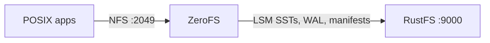
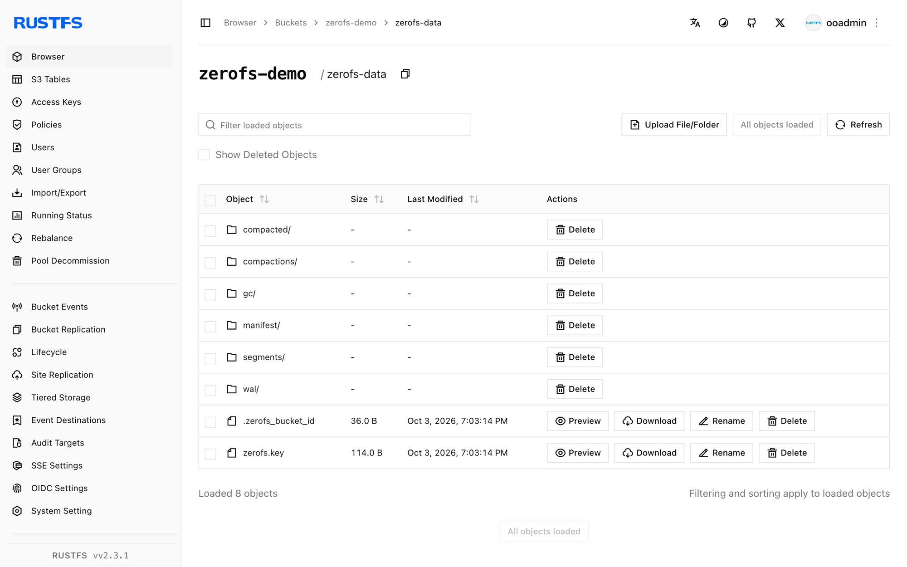

このガイドでは、S3 バケットを POSIX ファイルシステムとして提供するログ構造化ファイルシステムである [ZeroFS](https://github.com/Barre/ZeroFS) を、オブジェクトストレージのバックエンドとして **RustFS** に接続します。LSM ツリーのルートを RustFS のバケットに置いて ZeroFS を実行し、Linux ホストから NFS でファイルシステムをマウントし、マウント経由でファイルを書き込み、ZeroFS を再起動してもバケット内のオブジェクトとして残ることを確認します。手順は ZeroFS v2.3.5（ghcr.io/barre/zerofs）と `rustfs/rustfs-x86-musl:v2.3.1` の組み合わせで確認済みです。

Docker と、NFS クライアント（`nfs-common`）を備えた Linux ホストが必要です。このデプロイはローカルでの連携テスト用であり、本番向けではありません。

## アーキテクチャ



ZeroFS は、ファイルシステム操作をバケット内の LSM キーバリューツリーへ変換します。書き込みは先行書き込みログに入り、SST セグメントへフラッシュされ、コンパクションはバックグラウンドで実行されます。クライアントからは、NFS（または 9P/NBD）経由の通常のディレクトリツリーに見えます。

## 1. 設定を生成する

接続用のプレースホルダーをすべて置き換えて、バケットと設定ファイルを作成します。

```bash
rc mb rustfs/zerofs-demo

docker run --rm -u root:root -v /opt/zerofs:/cfg -w /cfg \
  --entrypoint /bin/sh ghcr.io/barre/zerofs:latest -c "zerofs init"
```

続けて `zerofs.toml` を編集し、storage セクションと AWS セクションが RustFS を指すようにします。

```toml title="zerofs.toml"
[cache]
dir = "/cache"
disk_size_gb = 5.0

[storage]
url = "s3://zerofs-demo/zerofs-data"
encryption_password = "${ZEROFS_PASSWORD}"

[servers.nfs]
addresses = ["0.0.0.0:2049"]

[servers.rpc]
addresses = ["0.0.0.0:7000"]

[aws]
access_key_id = "${AWS_ACCESS_KEY_ID}"
secret_access_key = "${AWS_SECRET_ACCESS_KEY}"
endpoint = "http://<your-rustfs-endpoint>:9000"
default_region = "us-east-1"
allow_http = "true"
```

`endpoint` と `allow_http` の組み合わせにより、ZeroFS の接続先が AWS から RustFS へ切り替わります。カスタムエンドポイントではパススタイルアクセスが使われるため、追加のオプションは不要です。

## 2. ZeroFS を実行する

設定ファイル、認証情報、書き込み可能なキャッシュディレクトリを指定してサーバーを実行します（イメージは UID 1001 で動作します）。

```bash
mkdir -p /opt/zerofs/cache && chown -R 1001:1001 /opt/zerofs/cache

docker run -d --name zerofs --network oo-rustfs_default -p 2049:2049 \
  -e ZEROFS_PASSWORD=<encryption-password> \
  -e AWS_ACCESS_KEY_ID=<your-access-key> \
  -e AWS_SECRET_ACCESS_KEY=<your-secret-key> \
  -v /opt/zerofs/zerofs.toml:/zerofs.toml:ro \
  -v /opt/zerofs/cache:/cache \
  ghcr.io/barre/zerofs:latest run -c /zerofs.toml
```

```text
INFO zerofs::nfs: NFS server listening on 0.0.0.0:2049
```

## 3. NFS でマウントする

ホストで、ZeroFS が推奨するオプションを使ってエクスポートをマウントします。

```bash
apt-get install -y nfs-common
mkdir -p /mnt/zerofs

mount -t nfs -o async,nolock,rsize=1048576,wsize=1048576,tcp,port=2049,mountport=2049,hard \
  127.0.0.1:/ /mnt/zerofs
```

マウントは通常の POSIX ファイルシステムです。

```bash
echo "written via zerofs nfs mount on rustfs" > /mnt/zerofs/hello.txt
dd if=/dev/urandom of=/mnt/zerofs/data/inner/blob.bin bs=1M count=8
```

## 4. 永続化と RustFS 内のオブジェクトを確認する

保留中の書き込みをバケットへ強制的に送り、ZeroFS を再起動して再マウントします。

```bash
docker exec zerofs zerofs flush -c /zerofs.toml
umount /mnt/zerofs
docker restart zerofs
mount -t nfs -o async,nolock,rsize=1048576,wsize=1048576,tcp,port=2049,mountport=2049,hard \
  127.0.0.1:/ /mnt/zerofs
```

再起動前に書き込んだ内容は、そのまま残っています。

```bash
cat /mnt/zerofs/hello.txt
sha1sum /mnt/zerofs/data/inner/blob.bin
```

```text
written via zerofs nfs mount on rustfs
645faaefe499f9ebda8edceeeb1a6261999aece7  /mnt/zerofs/data/inner/blob.bin
```

バケットを一覧し、ファイルの実体がどこにあるかを確認します。

```bash
rc ls rustfs/zerofs-demo/ -r | head -4
```

```text
zerofs-data/compacted/01M40Q1RA0X3AVG76VC0SBYE58.sst
zerofs-data/manifest/0000000000000000.json
zerofs-data/wal/00000000000000000001.sst
```

ファイルは 1 対 1 では保存されません。LSM ツリー内のキーと値として保存されるため、ZeroFS はバケットをファイルシステムとして提供できます。



## 5. 停止またはリセットする

バケット内のオブジェクトを残したまま、デモを解体します。

```bash
umount /mnt/zerofs
docker rm -f zerofs
```

保存データを削除します（ファイルシステム自体が消去されます）。

```bash
rc rm rustfs/zerofs-demo/ --recursive --force
```

## トラブルシューティング

### `[servers.webui]` で `Failed to parse config file: missing field uid` になる

ZeroFS v2.3.5 では、`[servers.webui]` セクションがある場合に `uid` と `gid` が必要です。`uid = 1000` と `gid = 1000` を追加するか、Web UI が不要ならセクションごと削除します。

### キャッシュディレクトリの作成時に `Permission denied` になる

コンテナは UID 1001 で動作します。キャッシュボリュームをマウントしたあと、コンテナを起動する前に `chown -R 1001:1001 <cache-dir>` を実行します。

### マウントが失敗する、またはハングする

NFS クライアントパッケージ（`nfs-common`）がインストールされていること、およびクライアントから到達できるネットワークで ZeroFS が `0.0.0.0:2049` を待ち受けていることを確認します。`port=2049,mountport=2049` が重要なのは、ZeroFS が mountd のトラフィックを同じポートで提供するためです。

### コンテナのクラッシュ後に書き込みが消える

ZeroFS は書き込みをバッファし、定期的にフラッシュします。デモでは `docker exec zerofs zerofs flush -c /zerofs.toml` を実行します。本番で厳密な耐久性が必要なクライアントには、fsync、または fsync が安定したストレージへの書き込み完了を待つ 9P マウントを推奨します。

## 次のステップ

- ほかの ZeroFS バックエンドを採用する前に、[S3 互換性に関する注意](/ja/administration/protocols/s3)を確認します。
- [アクセスキーの管理](/ja/security-compliance/iam/access-token)で、本番用の専用認証情報を作成します。
- キャッシュサイズ、9P/NBD の提供、同じバケット上の高可用性レプリケーションについては、[ZeroFS の設定ガイド](https://www.zerofs.net/configuration)に従います。
