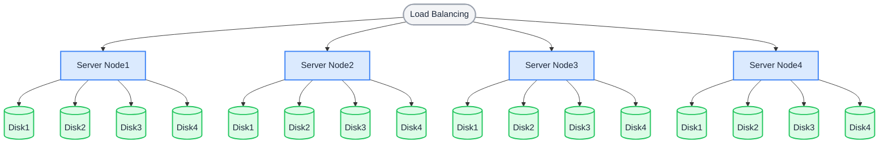

マルチノード・マルチディスク（MNMD）モードは、複数のサーバーにまたがるクラスター向けの本番デプロイです。分散オブジェクトストレージのクラスターを安全に起動するには、最低 **4 台のサーバー**が必要で、各サーバーに少なくとも 1 台のディスクが必要です。

## トポロジーと計画

次の構成では、リクエストはロードバランサーを通じて各サーバーに分散されます。既定の 12 + 4 のイレイジャーコーディング配置では、各オブジェクトは 12 個のデータシャードと 4 個のパリティシャードに分割され、異なるサーバー上の異なるディスクに保存されます。

- いずれか 1 台のサーバーが故障した場合や、メンテナンスのために停止した場合でも、クラスターは稼働を続け、データは失われません。
- 最大 4 台のディスクを失っても、データは失われません。



インストールの前に [インストール前チェックリスト](../requirement/checklists/index.md) を確認し、すべての項目が本番要件を満たしていることを確かめます。

## ホスト名

RustFS クラスターには、一貫した連番のホスト名（例: `node1` から `node4`）が必要です。連番のホスト名を用意する方法は 2 つあります。

**1. DNS の設定:**

各連番のホスト名が正しいノードに解決されるよう、DNS レコードを作成します。

**2. `/etc/hosts` の設定:**

すべてのノードの `/etc/hosts` に、次のエントリを追加します。

```text title="/etc/hosts"
127.0.0.1 localhost localhost.localdomain localhost4 localhost4.localdomain4
::1 localhost localhost.localdomain localhost6 localhost6.localdomain6
192.168.1.1 node1
192.168.1.2 node2
192.168.1.3 node3
192.168.1.4 node4
```

## 前提条件とサービスのセットアップ

**すべてのノード**で、[共通の前提条件とサービスのセットアップ](./prerequisites-and-service.md)（オペレーティングシステム、ファイアウォール、時刻同期、ディスクのフォーマット、サービスユーザー、バイナリのダウンロード、systemd ユニット）を完了してから、以下に進みます。すべてのノードで、待受ポートを同じにし、クロックを同期させる必要があります。

## 環境変数を設定する

1. すべてのノードに同じ設定ファイルを作成します。`RUSTFS_VOLUMES` は、ブレース展開ですべてのノードとすべてのディスクマウントポイントを列挙します（この例: 4 ノード × 4 ディスク）。

```ini title="/etc/default/rustfs"
# Use a unique access key and a strong, random secret (e.g. openssl rand -base64 24)
RUSTFS_ACCESS_KEY=<your-access-key>
RUSTFS_SECRET_KEY=<your-secret-key>
RUSTFS_VOLUMES="http://node{1...4}:9000/data/rustfs{0...3}"
RUSTFS_ADDRESS=":9000"
RUSTFS_CONSOLE_ENABLE=true
RUSTFS_CONSOLE_ADDRESS=":9001"
RUSTFS_OBS_LOGGER_LEVEL=error
RUSTFS_OBS_LOG_DIRECTORY="/var/log/rustfs/"
```

:::note

アクセスキー、シークレットキー、および `RUSTFS_VOLUMES` の値は、すべてのノードで同一である必要があります。ホスト名（`node1` ～ `node4`）は、上記の DNS または `/etc/hosts` の設定と一致している必要があります。

:::

2. すべてのノードで、ストレージとログのディレクトリを作成します。

```bash
sudo mkdir -p /data/rustfs{0..3} /var/log/rustfs /opt/tls
sudo chmod -R 750 /data/rustfs* /var/log/rustfs
```

## サービスを起動して確認する

1. すべてのノードでサービスを起動し、起動時の自動開始を有効にします。

```bash
sudo systemctl enable --now rustfs
```

2. サービスの状態を確認します。

```bash
systemctl status rustfs
```

3. サービスのポートを確認します。

```bash
netstat -ntpl
```

4. ログファイルを表示します。

```bash
tail -f /var/log/rustfs/rustfs*.log
```

5. Console にアクセスします。ブラウザーに任意のノードの IP アドレス（またはロードバランサーのアドレス）と Console のポート（既定は 9001）を入力すると、次のように表示されます。


## 次のステップ

- クラスターの前段にロードバランサーを置きます。[Nginx 連携ガイド](/ja/developer/integration/reverse-proxy/nginx) を参照します。
- 本番トラフィックでは TLS を有効にします。[TLS の設定](../../integration/tls-configured.md) を参照します。
- スケールする前に、[ストレージプールの拡張](../../operations/scaling/storage-pool-expansion.md) を確認します。
