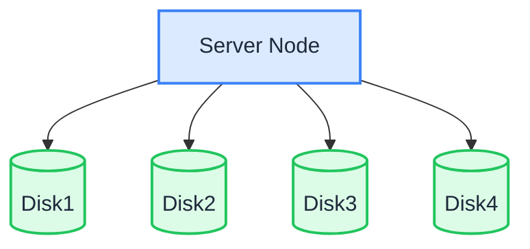

シングルノード・マルチディスク（SNMD）モードでは、1 台のサーバーが複数のデータディスクにデータを分散します。各オブジェクトは K 個のデータシャードと M 個のパリティシャード（イレイジャーコーディング）に分割されるため、最大 M 台のディスクを失ってもデータは失われません。

:::warning

SNMD は、中規模で重要度の低いワークロードに適しています。このデプロイでは、最大 M 台のディスクを失ってもデータは失われません。ただし、サーバー全体が故障した場合、または M 台を超えるディスクが損傷した場合は、データが失われます。重要なデータはバックアップを残します。ノード単位の耐障害性には、[MNMD](./multiple-node-multiple-disk.md) を使います。

:::

## トポロジーと計画



- 複数のデータディスクを持つサーバー 1 台（この例では `/data/rustfs0` から `/data/rustfs3` にマウントした 4 台のディスク）。
- イレイジャーコーディングは、データシャードとパリティシャードをディスク間に分散します。耐障害性は、単一ノード内のディスク障害に限られます。
- 前提条件のページで説明しているとおり、各ディスクを XFS でフォーマットし、個別にマウントします（例: ラベル `RUSTFS0` ～ `RUSTFS3`）。
- 本番デプロイでは、[インストール前チェックリスト](../requirement/checklists/index.md) も確認します。

## 前提条件とサービスのセットアップ

[共通の前提条件とサービスのセットアップ](./prerequisites-and-service.md)（オペレーティングシステム、ファイアウォール、時刻同期、ディスクのフォーマット、サービスユーザー、バイナリのダウンロード、systemd ユニット）を完了してから、以下に進みます。

## 環境変数を設定する

1. 設定ファイルを作成します。`RUSTFS_VOLUMES` は、ブレース展開で 4 つのディスクマウントポイントを列挙します。

```ini title="/etc/default/rustfs"
# Use a unique access key and a strong, random secret (e.g. openssl rand -base64 24)
RUSTFS_ACCESS_KEY=<your-access-key>
RUSTFS_SECRET_KEY=<your-secret-key>
RUSTFS_VOLUMES="/data/rustfs{0...3}"
RUSTFS_ADDRESS=":9000"
RUSTFS_CONSOLE_ENABLE=true
RUSTFS_CONSOLE_ADDRESS=":9001"
RUSTFS_OBS_LOGGER_LEVEL=error
RUSTFS_OBS_LOG_DIRECTORY="/var/log/rustfs/"
```

2. ストレージとログのディレクトリを作成します。

```bash
sudo mkdir -p /data/rustfs{0..3} /var/log/rustfs /opt/tls
sudo chmod -R 750 /data/rustfs* /var/log/rustfs
```

## サービスを起動して確認する

1. サービスを起動し、起動時に開始するよう有効にします。

```bash
sudo systemctl enable --now rustfs
```

2. サービスの状態を確認します。

```bash
systemctl status rustfs
```

3. サービスのポートを確認します。

```bash
netstat -ntpl
```

4. ログファイルを表示します。

```bash
tail -f /var/log/rustfs/rustfs*.log
```

5. Console にアクセスします。ブラウザーにサーバーの IP アドレスと Console のポート（既定は 9001）を入力すると、次のように表示されます。


## 次のステップ

- ノード単位の耐障害性と水平スケーラビリティが必要な場合は、[マルチノード・マルチディスク（MNMD）](./multiple-node-multiple-disk.md) を参照します。
- 試すだけの場合は、[シングルノード・シングルディスク（SNSD）](./single-node-single-disk.md) のほうがセットアップは簡単です。
