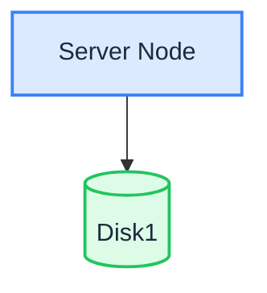

シングルノード・シングルディスク（SNSD）モードでは、1 台のサーバーがすべてのデータを 1 台のデータディスクに保存します。最も単純なデプロイ方式であり、[Linux クイックスタート](./quick-start.md) のスクリプトが設定するトポロジーと同じです。

:::warning

ディスクが 1 台の場合、冗長性はありません。ディスクが故障するとデータは失われます。SNSD は、開発、テスト、および小規模で重要度の低いワークロードに適しています。本番で使う場合は、定期的なデータバックアップを維持するか、[SNMD](./single-node-multiple-disk.md) または [MNMD](./multiple-node-multiple-disk.md) を選びます。

:::

## トポロジーと計画



- サーバー 1 台、データディスク 1 台（例: `/data/rustfs0` にマウントした XFS フォーマットのディスク）。
- ディスク間のイレイジャーコーディングはありません。耐障害性はすべてバックアップに依存します。
- 本番デプロイでは、[インストール前チェックリスト](../requirement/checklists/index.md) も確認します。

## 前提条件とサービスのセットアップ

[共通の前提条件とサービスのセットアップ](./prerequisites-and-service.md)（オペレーティングシステム、ファイアウォール、時刻同期、ディスクのフォーマット、サービスユーザー、バイナリのダウンロード、systemd ユニット）を完了してから、以下に進みます。

## 環境変数を設定する

1. シングルディスクのボリュームパスを含む設定ファイルを作成します。

```ini title="/etc/default/rustfs"
# Use a unique access key and a strong, random secret (e.g. openssl rand -base64 24)
RUSTFS_ACCESS_KEY=<your-access-key>
RUSTFS_SECRET_KEY=<your-secret-key>
RUSTFS_VOLUMES="/data/rustfs0"
RUSTFS_ADDRESS=":9000"
RUSTFS_CONSOLE_ENABLE=true
RUSTFS_CONSOLE_ADDRESS=":9001"
RUSTFS_OBS_LOGGER_LEVEL=error
RUSTFS_OBS_LOG_DIRECTORY="/var/log/rustfs/"
```

2. ストレージとログのディレクトリを作成します。

```bash
sudo mkdir -p /data/rustfs0 /var/log/rustfs /opt/tls
sudo chmod -R 750 /data/rustfs* /var/log/rustfs
```

## サービスを起動して確認する

1. サービスを起動し、起動時に開始するよう有効にします。

```bash
sudo systemctl enable --now rustfs
```

2. サービスの状態を確認します。

```bash
systemctl status rustfs
```

3. サービスのポートを確認します。

```bash
netstat -ntpl
```

4. ログファイルを表示します。

```bash
tail -f /var/log/rustfs/rustfs*.log
```

5. Console を開きます。ブラウザーで `http://<server-ip>:9001` にアクセスすると、次のように表示されます。


## 次のステップ

- 1 台のサーバーでディスク単位の冗長性が必要な場合は、[シングルノード・マルチディスク（SNMD）](./single-node-multiple-disk.md) を参照します。
- 本番クラスターが必要な場合は、[マルチノード・マルチディスク（MNMD）](./multiple-node-multiple-disk.md) を参照します。
