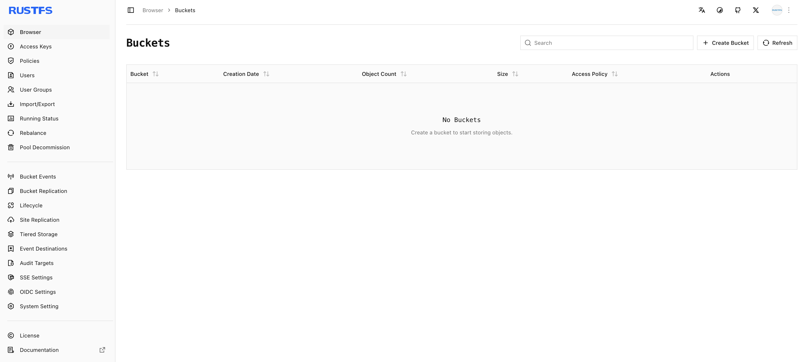

このガイドでは、Windows で **RustFS** を実行する 2 つの方法を説明します。グラフィカルな **RustFS Launcher** を使う方法と、PowerShell からスタンドアロンのサーバーバイナリをダウンロードして実行する方法です。どちらも、評価、開発、テストに適したローカルのシングルノードインスタンスを作成します。

:::warning[開発とデバッグ専用]

Windows 版の RustFS は、開発とデバッグ専用であり、**本番デプロイには推奨しません**。本番ワークロードには [Linux](/ja/installation/linux) を推奨します。

これらの手順では、RustFS を Windows サービスとしてではなく、デスクトッププロセスとして実行します。本番または分散デプロイには、[Linux のインストールガイド](/ja/installation/linux) を使います。

:::

## 1. 前提条件を確認する

始める前に、次を確認します。

- 使用しているのは、x86-64 プロセッサー上の 64 ビット Windows です。Launcher は現在、Windows x86-64 の RustFS バイナリを同梱しています。
- アプリケーションのインストールまたは実行と、選択したデータディレクトリへの書き込みの権限があります。
- TCP ポート `9000` と `9001` が空いているか、ほかの未使用ポートを 2 つ選んでいます。
- `D:\rustfs\data` のような専用のデータディレクトリを作成しています。

:::warning[データディレクトリを保護する]

空き容量が十分なディスク上の空のディレクトリを使います。このディレクトリに無関係なファイルを置かず、サーバーの実行中に RustFS のデータファイルを編集しないでください。

:::

## 2. インストール方法を選ぶ

| 方法 | 使う場面 | 管理モデル |
| --- | --- | --- |
| RustFS Launcher | グラフィカルなセットアップと組み込みのログビューアーが必要な場合。 | Launcher が、同梱の RustFS プロセスを起動し、停止します。 |
| スタンドアロンバイナリ | 明示的な PowerShell コマンドやスクリプトが必要な場合。 | RustFS プロセスは、その PowerShell セッションに属します。 |

## RustFS Launcher でインストールする

### 3. Launcher をダウンロードしてインストールする

1. [RustFS Launcher の Releases ページ](https://github.com/rustfs/launcher/releases) を開きます。
2. 最新のリリースを選び、**Assets**（アセット）から Windows x86-64 のインストーラーをダウンロードします。ソースから Launcher をビルドするための **Source code**（ソースコード）はダウンロードしないでください。
3. インストーラーをダブルクリックし、画面の指示に従います。
4. 自動で開かない場合は、スタートメニューから **RustFS Launcher** を開きます。

Microsoft Defender SmartScreen が警告を表示した場合は、実行を許可する前に、インストーラーが公式の `rustfs/launcher` Releases ページから入手したものであることを確認します。Windows のセキュリティ機能をシステム全体で無効にしないでください。

### 4. Launcher を設定する

Launcher ウィンドウの各フィールドを設定します。

| セクション | フィールド | 推奨値 | 説明 |
| --- | --- | --- | --- |
| Dataset Mount（データセットのマウント） | Data Path（データパス） | `D:\rustfs\data` | RustFS がオブジェクトデータを保存する、既存のディレクトリ。 |
| Ports & Access（ポートとアクセス） | API Port（API ポート） | `9000` | S3 互換 API のポート。 |
| Ports & Access | Host（ホスト） | `127.0.0.1` | アクセスをこのコンピューターに制限します。 |
| Ports & Access | Console Endpoint（Console エンドポイント） | Enabled（有効） | Web Console を有効にします。Launcher は既定で無効にしています。 |
| Ports & Access | Console Port（Console ポート） | `9001` | Console のポート。API ポートとは異なる必要があります。 |
| Credentials（認証情報） | Access Key（アクセスキー） | `<your-access-key>` | このインスタンスの管理者アクセスキー。 |
| Credentials | Secret Key（シークレットキー） | `<your-secret-key>` | このインスタンスの管理者シークレットキー。 |

**Browse**（参照）でデータディレクトリを選ぶか、Launcher にドラッグします。Launcher は、起動前にディレクトリが存在していることを要求します。

認証情報のプレースホルダーを独自の値に置き換えます。Launcher は最初、ローカルテスト用の既定の認証情報を表示します。ほかのユーザーがアクセスできるコンピューターでは、その値を残さないでください。

:::warning[ネットワークへの公開]

別のコンピューターが RustFS に接続する必要がある場合を除き、**Host** は `127.0.0.1` のままにします。ループバック以外のアドレスは、対応するネットワークインターフェース上で API と Console を公開します。リモートアクセスを許可する前に、Windows Defender ファイアウォールと強力な認証情報を設定します。

:::

### 5. RustFS を起動して確認する

1. **Launch RustFS**（RustFS を起動）を選びます。
2. 設定したエンドポイントがオンラインになったと Launcher が報告するまで待ちます。
3. `http://localhost:9001` を開き、設定したアクセスキーとシークレットキーでサインインします。
4. S3 互換クライアントのエンドポイントとして `http://localhost:9000` を使います。


ホストまたはポートを変更した場合は、その値を使います。Console の URL は、**Console Endpoint** が有効な場合にのみ使えます。

Launcher は、実行中のプロセスを管理している間、設定をロックします。また、データディレクトリの隣に `logs` ディレクトリを作成します。たとえば、データパスが `D:\rustfs\data` の場合、サーバーのログファイルは `D:\rustfs\logs` に置かれます。

### 6. Launcher を停止または終了する

設定を変更する前、データディスクを取り外す前、または Windows をシャットダウンする前に、**Stop RustFS**（RustFS を停止）を選びます。

Launcher ウィンドウを閉じると、Windows のシステムトレイに隠れるだけで、RustFS は停止しません。管理対象のプロセスを停止して Launcher を終了するには、トレイアイコンを右クリックして **Quit**（終了）を選びます。ウィンドウを戻すには、**Show**（表示）を選ぶか、トレイアイコンを左クリックします。

## スタンドアロンバイナリをインストールする

### 7. バイナリをダウンロードして展開する

1. [RustFS の Releases ページ](https://github.com/rustfs/rustfs/releases) を開きます。
2. 必要なリリースを選び、**Assets** から Windows x86-64 の ZIP アーカイブをダウンロードします。アセット名は `rustfs-windows-x86_64` で始まります。
3. PowerShell を開き、プログラムとデータのディレクトリを作成します。

```powershell
New-Item -ItemType Directory -Force -Path C:\rustfs\bin
New-Item -ItemType Directory -Force -Path D:\rustfs\data
```

4. ダウンロードしたアーカイブを展開します。`<version>` は、ダウンロードしたファイル名のバージョンに置き換えます。

```powershell
Expand-Archive -Path "$HOME\Downloads\rustfs-windows-x86_64-<version>.zip" -DestinationPath C:\rustfs\bin -Force
```

5. 展開したバイナリが実行できることを確認します。

```powershell
Set-Location C:\rustfs\bin
.\rustfs.exe --help
```

アーカイブが `rustfs.exe` をネストしたディレクトリに展開した場合は、続ける前にそのディレクトリへ移動するか、実行ファイルを `C:\rustfs\bin` に移動します。

### 8. スタンドアロンサーバーを起動する

現在の PowerShell セッションだけに認証情報を設定し、明示的なアドレスで RustFS を起動します。

```powershell
$env:RUSTFS_ACCESS_KEY = "<your-access-key>"
$env:RUSTFS_SECRET_KEY = "<your-secret-key>"

Set-Location C:\rustfs\bin
.\rustfs.exe server `
	--address "127.0.0.1:9000" `
	--console-enable true `
	--console-address "127.0.0.1:9001" `
	"D:\rustfs\data"
```

RustFS の実行中は、PowerShell ウィンドウを開いたままにします。そのウィンドウで `Ctrl+C` を押すと、サーバーが停止します。

:::tip[認証情報の扱い]

セッションの環境変数を使うと、認証情報をコマンドラインに直接置かずに済みます。繰り返し使う場合や自動化する場合は、`RUSTFS_ACCESS_KEY_FILE` と `RUSTFS_SECRET_KEY_FILE` の環境変数を使い、それらのファイルを Windows のアクセス制御で保護することを推奨します。

:::

### 9. スタンドアロンサーバーを確認する

`http://localhost:9001` を開き、設定した認証情報でサインインします。S3 互換クライアントのエンドポイントとして `http://localhost:9000` を使います。RustFS は既定でパススタイルアクセスになるため、クライアントもそれに合わせて設定します。

エンドツーエンドで確認するには、`my-bucket` という名前のバケットを作成し、`hello.txt` をアップロードして、オブジェクトがバケットに表示されることを確認します。

## インストールの成功を確認する

Launcher とスタンドアロンバイナリのどちらを使った場合でも、Console へのサインインが成功すると **Buckets**（バケット）ページが開きます。ここから `my-bucket` を作成し、オブジェクトの保存を始められます。



## トラブルシューティング

### Windows がインストーラーまたは実行ファイルをブロックする

ファイルが公式の RustFS GitHub 組織から入手したものであることを確認します。ファイルの **Properties**（プロパティ）ダイアログを確認し、Windows がその選択肢を出した場合に限り、入手元を確認したうえで **Unblock**（ブロックの解除）を選びます。

### データパスが拒否される

ディレクトリが存在し、Windows アカウントに読み取りと書き込みの権限があることを確認します。Launcher は、選択したデータディレクトリを自動では作成しません。

### API または Console のポートが使えない

ポートは、`1` から `65535` の数値であり、互いに異なり、かつ未使用である必要があります。PowerShell で既定のポートを確認します。

```powershell
Get-NetTCPConnection -LocalPort 9000,9001 -ErrorAction SilentlyContinue
```

競合しているアプリケーションを停止するか、未使用のポートを選んでから、RustFS を再度起動します。

### Console が開かない

Launcher の場合は、**Console Endpoint** が有効であることを確認します。スタンドアロンバイナリの場合は、プロセスがまだ実行中であり、`--console-enable true` があることを確認します。現在の Console の既定ポートは `9001` です。現在の Launcher の設定では、ポート `7001` は使いません。

### Launcher が外部の RustFS プロセスを報告する

別のプロセスが、設定した API アドレスで待ち受けていますが、Launcher はそのプロセスを起動していません。そのプロセスを停止するか、別の API ポートを選びます。Launcher は、自身が管理していないプロセスを停止できません。

### 起動後に RustFS が終了する

Launcher では、組み込みログビューアーのアプリケーションタブと RustFS タブの両方を確認します。スタンドアロンインストールでは、PowerShell の出力を確認します。よくある原因は、データディレクトリがないこと、権限が不足していること、ポートの競合です。

## 次のステップ

- クライアントを接続する前に、[S3 API ガイド](/ja/administration/protocols/s3) を確認します。
- [バケットを作成する](/ja/administration/data/bucket/creation) 方法を確認します。
- 追加の確認方法は、[ステータスチェック](/ja/operations/status-check) を参照します。
- 本番向けのデプロイには、[Linux のインストールガイド](/ja/installation/linux) を使います。
