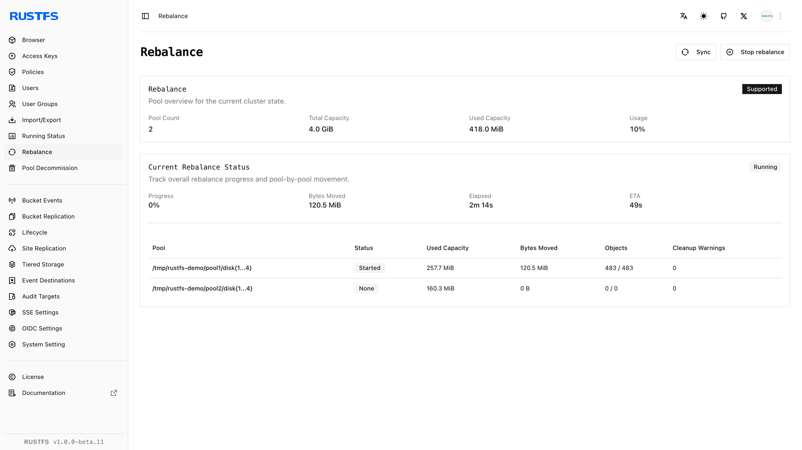

## 概要

### 要件

- このガイドで `rc` の手順を使う前に、管理用ホストに [`rc`](/ja/operations/rc) をインストールします。
- リバランスを管理する権限を持つ認証情報を設定します。

[プールの拡張](./storage-pool-expansion.md) のあと、新しい書き込みは追加された容量を使えます。既存のオブジェクトは元のプールに残ります。**リバランス**は、使用容量の比率が近づくように、既存のオブジェクトを稼働中のすべてのプールへ移動します。

リバランスには、稼働中のプールが 2 つ以上必要です。別のリバランス、またはプールのデコミッションが実行中のときは、RustFS は新しいリバランスを拒否します。リバランスを停止しても、すでに移動したオブジェクトは元のプールへは戻りません。

開始前に、すべてのノードとディスクが正常であること、デコミッションが実行中でないこと、操作中の通常の書き込みに足りる空き容量がクラスターにあることを確認します。オブジェクトの移動はディスク、ネットワーク、CPU を消費するため、トラフィックの少ない時間帯に実施します。

## 操作

### Console でリバランスを開始する

1. リバランスを管理する権限を持つアカウントで、RustFS Console にサインインします。
2. **Rebalance**（リバランス）を開きます。
3. 稼働中のプールと、それぞれの使用容量の比率を確認します。
4. **Start Rebalance**（リバランスを開始）を選択し、操作を確定します。
5. ページを開いたままにするか、定期的に戻って、プールごとの進捗を確認します。
6. 操作を中断する必要がある場合に限り、**Stop Rebalance**（リバランスを停止）を使います。すでに移動したデータは、新しいプールに残ります。



### rc でリバランスを開始する

クラスターのエイリアスが未設定の場合は、設定します。

```bash
rc alias set rustfs http://<server-ip>:9000 <your-access-key> <your-secret-key>
```

リバランスを開始します。

```bash
rc admin rebalance start rustfs
```

進捗を確認します。

```bash
rc admin rebalance status rustfs
```

ステータスには、操作 ID に加え、プールごとの使用量、移動済みバイト数、オブジェクト数とバージョン数、残りのバケット、経過時間、取得できる場合は完了見込み時刻が含まれます。

実行中のリバランスを停止するには、次を実行します。

```bash
rc admin rebalance stop rustfs
```

`rc admin expand start|status|stop` と `scale` エイリアスは、拡張後のリバランスと同じ手順を提供します。

## 検証

### Console でリバランスを検証する

**Rebalance** ページが `Completed` を報告するまで待ち、次を確認します。


- 失敗または停止を報告しているプールがないこと。
- 稼働中のプールの間で、使用容量の比率がより近づいていること。
- すべてのノードとディスクがオンラインのままであること。
- オブジェクトの通常の読み取りと書き込みが成功すること。

### rc でリバランスを検証する

次を実行します。

```bash
rc admin rebalance status rustfs
rc admin pool list rustfs
```

リバランスのステータスが `Completed` であり、残りのバケット数が 0 で、失敗が報告されていないことを確認します。プールごとの使用量の比率を、操作前に記録した値と比較します。その後、S3 エンドポイント経由で既存のオブジェクトを読み取り、新しいテストオブジェクトを書き込みます。
