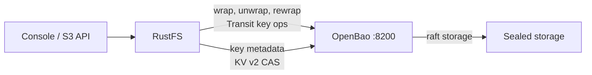
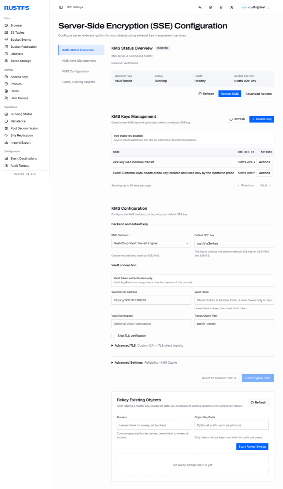

[OpenBao](https://github.com/openbao/openbao) は HashiCorp Vault のオープンソースフォークです。RustFS は Vault Transit バックエンドで外部 KMS を介して SSE-KMS キーを管理し、OpenBao は同じ API サーフェスを維持しています。そのため RustFS のコード変更は不要で、統合は設定のみで完結します。このガイドでは OpenBao をデプロイし、シークレットエンジンと最小権限トークンを準備し、RustFS を設定して、SSE-KMS をエンドツーエンドで検証します。このワークフローは RustFS `1.0.5` と OpenBao `2.7.2` で検証しました。

OpenBao ホストの Docker と、RustFS 1.0.5 以降のサーバーが必要です。このガイドは統合テスト用のシングルノードデプロイです。本番ではクラスター化された OpenBao と管理されたアンシールが追加で必要になります。詳細は末尾を参照してください。

## アーキテクチャ



RustFS はオブジェクトごとのデータキーをローカルで生成し、OpenBao の Transit エンジン経由でラップします。キーのライフサイクルメタデータは CAS 書き込み付きの KV v2 マウントに保持されます。マスターキーのバージョンは OpenBao が保持するため、OpenBao が停止すると、新しい SSE-KMS 書き込みと暗号化オブジェクトの読み取りは、到達可能かつアンシールされるまで停止します。

## 1. TLS と raft ストレージ付きで OpenBao をデプロイする

RustFS は KMS への平文 HTTP を拒否します。起動時に `Vault Transit requires HTTPS outside explicit development mode` で失敗します。最初から OpenBao に TLS を設定してください。ディレクトリ構成と、統合 raft ストレージを使う設定を作成します：

```bash
mkdir -p /data/openbao/{data,config,tls}
openssl req -x509 -newkey rsa:4096 -sha256 -days 825 -nodes \
  -keyout /data/openbao/tls/ca-key.pem -out /data/openbao/tls/ca.pem \
  -subj "/CN=openbao-demo-ca"
openssl req -newkey rsa:2048 -nodes -keyout /data/openbao/tls/server-key.pem \
  -out /data/openbao/tls/server.csr -subj "/CN=openbao-host"
openssl x509 -req -in /data/openbao/tls/server.csr \
  -CA /data/openbao/tls/ca.pem -CAkey /data/openbao/tls/ca-key.pem \
  -CAcreateserial -out /data/openbao/tls/server-cert.pem -days 825 -sha256 \
  -extfile <(printf "subjectAltName=IP:127.0.0.1,DNS:localhost,DNS:openbao-host")
```

```hcl title="/data/openbao/config/config.hcl"
storage "raft" {
  path    = "/openbao/data"
  node_id = "openbao-1"
}
listener "tcp" {
  address         = "0.0.0.0:8200"
  cluster_address = "0.0.0.0:8201"
  tls_disable     = 0
  tls_cert_file   = "/openbao/tls/server-cert.pem"
  tls_key_file    = "/openbao/tls/server-key.pem"
}
api_addr      = "https://127.0.0.1:8200"
cluster_addr  = "https://127.0.0.1:8201"
disable_mlock = true
ui            = false
```

データ・設定・TLS ディレクトリをマウントしてコンテナを起動します。各バインドマウントはコンテナプロセスから書き込み可能である必要があります：

```bash
chmod -R a+rX /data/openbao/tls
chmod 777 /data/openbao/data
docker run -d --name openbao --restart unless-stopped \
  -p 127.0.0.1:8200:8200 \
  -v /data/openbao/data:/openbao/data \
  -v /data/openbao/config:/openbao/config \
  -v /data/openbao/tls:/openbao/tls \
  openbao/openbao:2.7.2 server
```

キーシェア 1 つで初期化し、アンシールします。アンシールキーとルートトークンは一度しか表示されないため、安全に保管してください：

```bash
docker exec -e BAO_ADDR=https://127.0.0.1:8200 -e BAO_CACERT=/openbao/tls/ca.pem \
  openbao bao operator init -key-shares=1 -key-threshold=1 -format=json
```

コンテナを再起動するたびに再度アンシールします：

```bash
docker exec -e BAO_ADDR=https://127.0.0.1:8200 -e BAO_CACERT=/openbao/tls/ca.pem \
  openbao bao operator unseal <unseal-key>
```

## 2. シークレットエンジンを有効化し、スコープ限定トークンを作成する

RustFS には 2 つのエンジンが必要です。キー操作のための Transit と、RustFS が管理するキーメタデータのための KV v2 です。専用のマウントを作成します：

```bash
docker exec -e BAO_ADDR=https://127.0.0.1:8200 -e BAO_CACERT=/openbao/tls/ca.pem \
  -e BAO_TOKEN=<root-token> openbao \
  bao secrets enable -path=rustfs-transit transit
docker exec -e BAO_ADDR=https://127.0.0.1:8200 -e BAO_CACERT=/openbao/tls/ca.pem \
  -e BAO_TOKEN=<root-token> openbao \
  bao secrets enable -path=rustfs-meta -version=2 kv
```

RustFS の KMS クライアントが必要とする権限だけを与えるポリシーを書きます。Transit キー管理（起動プローブが依存する LIST を含む）、暗号化操作、設定したプレフィックスに対応する KV v2 の data と metadata パスです：

```hcl title="rustfs-kms.hcl"
path "rustfs-transit/keys" {
  capabilities = ["list"]
}
path "rustfs-transit/keys/*" {
  capabilities = ["create", "read", "update", "delete", "list"]
}
path "rustfs-transit/encrypt/*" {
  capabilities = ["create", "update"]
}
path "rustfs-transit/decrypt/*" {
  capabilities = ["create", "update"]
}
path "rustfs-transit/rewrap/*" {
  capabilities = ["create", "update"]
}
path "rustfs-transit/keys/*/rotate" {
  capabilities = ["update"]
}
path "rustfs-transit/keys/*/config" {
  capabilities = ["read", "update"]
}
path "rustfs-meta/data/rustfs/kms/keys/*" {
  capabilities = ["create", "update", "read"]
}
path "rustfs-meta/metadata/rustfs/kms/keys/*" {
  capabilities = ["read", "list", "delete"]
}
```

ポリシーを読み込み、orphan トークンを発行します：

```bash
docker cp rustfs-kms.hcl openbao:/tmp/rustfs-kms.hcl
docker exec -e BAO_ADDR=https://127.0.0.1:8200 -e BAO_CACERT=/openbao/tls/ca.pem \
  -e BAO_TOKEN=<root-token> openbao \
  bao policy write rustfs-kms /tmp/rustfs-kms.hcl
docker exec -e BAO_ADDR=https://127.0.0.1:8200 -e BAO_CACERT=/openbao/tls/ca.pem \
  -e BAO_TOKEN=<root-token> openbao \
  bao token create -policy=rustfs-kms -orphan -format=json
```

トークンを RustFS ホストに保存します。ファイルは所有者のみが読める権限で、`rustfs` サービスアカウントの所有である必要があります。グループやその他の読み取りビットがあると RustFS は拒否します：

```bash
install -d -m 0755 -o rustfs -g rustfs /data/rustfs/kms
install -m 0600 -o rustfs -g rustfs /dev/null /data/rustfs/kms/openbao-token
# write the token into /data/rustfs/kms/openbao-token
cp /data/openbao/tls/ca.pem /data/rustfs/kms/openbao-ca.pem
```

## 3. RustFS を設定する

KMS 設定を RustFS の環境ファイルに追加して再起動します：

```ini title="/etc/default/rustfs"
RUSTFS_KMS_ENABLE=true
RUSTFS_KMS_BACKEND=vault-transit
RUSTFS_KMS_VAULT_ADDRESS=https://127.0.0.1:8200
RUSTFS_KMS_VAULT_MOUNT_PATH=rustfs-transit
RUSTFS_KMS_VAULT_TOKEN_FILE=/data/rustfs/kms/openbao-token
RUSTFS_KMS_VAULT_TRANSIT_METADATA_KV_MOUNT=rustfs-meta
RUSTFS_KMS_VAULT_TRANSIT_METADATA_PREFIX=rustfs/kms/keys
RUSTFS_KMS_VAULT_CA_CERT=/data/rustfs/kms/openbao-ca.pem
```

```bash
sudo systemctl restart rustfs
```

バックエンドの検証に失敗すると、RustFS は起動を拒否し、ログに具体的な原因を出力します。[トラブルシューティング](#トラブルシューティング)を参照してください。起動すれば、コンソールの **SSE 設定**または管理 API で KMS の状態を確認できます：

```bash
curl -s http://localhost:9000/rustfs/admin/v3/kms/service-status
```

レスポンスは `"backend_type":"VaultTransit"` と `"healthy":true`、設定したアドレス、マウントパス、カスタム CA の使用有無を報告します。

## 4. キーを作成し、デフォルトを選択する

コンソールの **SSE 設定** には KMS のライフサイクル全体が用意されています。状態概要、キー管理（作成、二段階削除）、バックエンド設定、既存オブジェクトの再暗号化スイープです。

**KMS Keys Management** でキーを作成すると、RustFS は OpenBao 内の対応する Transit キーと、KV v2 マウント内のメタデータレコードを同時に作成します。その後、コンソールまたは環境変数で **デフォルト SSE キー** を設定します：

```ini title="/etc/default/rustfs"
RUSTFS_KMS_DEFAULT_KEY_ID=rustfs-e2e-key
```

デフォルトを変更したら RustFS を再起動してください。RustFS を経由せずに OpenBao で直接キーを作成すると、KV v2 のメタデータレコードが欠落します。キーは RustFS 側から作成してください。



## 5. SSE-KMS をエンドツーエンドで検証する

バケットのデフォルトを設定するか、書き込みごとにキーを指定します。アップロードのレスポンスは暗号化アルゴリズムとキー ID を返し、ダウンロードは元のバイト列を返します：

```bash
aws s3api put-object \
  --endpoint-url http://localhost:9000 \
  --bucket my-bucket --key docs/e2e-check.txt \
  --body ./e2e-check.txt \
  --server-side-encryption aws:kms \
  --ssekms-key-id rustfs-e2e-key
```

```json
{
    "ETag": "\"57a02aed...\"",
    "ServerSideEncryption": "aws:kms",
    "SSEKMSKeyId": "rustfs-e2e-key"
}
```

```bash
aws s3api get-object \
  --endpoint-url http://localhost:9000 \
  --bucket my-bucket --key docs/e2e-check.txt ./e2e-check-back.txt
```

## 検証結果

以下の検査は稼働中の OpenBao 2.7.2 デプロイに対して実施したもので、健全な環境では同じ結果になります：

| 検査 | 期待される結果 |
| --- | --- |
| キー ID を使った SSE-KMS PUT/GET | レスポンスが `aws:kms` とキー ID を返し、ダウンロードしたバイト列が一致 |
| 暗号化オブジェクトへの Range GET | バイト範囲が正しく返る |
| RustFS の再起動 | キーメタデータが KV v2 から復元され、暗号化オブジェクトは読み取り可能のまま |
| OpenBao の再起動（sealed） | 暗号化読み取りは `ServiceUnavailable` で失敗し、平文へのフォールバックなし。アンシール後、読み取りはプローブ間隔で自動回復 |
| Transit キーのローテーション | `latest_version` が増加し旧バージョンは保持される。ローテーション前にラップされたオブジェクトは読み取り可能のまま |
| ストレージ上の暗号文の改ざん | 読み取りが失敗し、削除も拒否される。平文へのフォールバックなし |
| 誤った暗号化コンテキスト | Transit の復号がメッセージ認証エラーで失敗する |

ストレージレイアウトに関する注記：小さいオブジェクトは暗号化済みバイトを各ディスクの `xl.meta` ファイルにインラインで格納します。そのためオブジェクトディレクトリへの平文 grep は、データが存在してもヒットしません。

## トラブルシューティング

### 起動が `Vault Transit requires HTTPS outside explicit development mode` で失敗する

KMS アドレスが HTTPS ではありません。OpenBao に TLS を設定し、`RUSTFS_KMS_VAULT_CA_CERT` でその CA を信頼してください。逃げ道の `RUSTFS_KMS_ALLOW_INSECURE_DEV_DEFAULTS=true` は開発専用です。

### 起動が `Vault token file ... has insecure permissions 0o644` で失敗する

トークンファイルは `0600` 権限（グループとその他のビットなし）で、RustFS サービスアカウントの所有である必要があります：

```bash
chown rustfs:rustfs /data/rustfs/kms/openbao-token
chmod 600 /data/rustfs/kms/openbao-token
```

### OpenBao が sealed の間に読み取りが `ServiceUnavailable` で失敗する

想定された動作です。暗号化読み取りには外部 KMS が必要です。OpenBao をアンシールしてください。RustFS は次の KMS プローブで自動的に回復し、RustFS の再起動は不要です。

### OpenBao transit が誤った `context` パラメータでも復号できる

派生なしキーでは、transit は `context` を無視し、S3 の暗号化コンテキストを `associated_data` としてバインドします。誤った `associated_data` は `cipher: message authentication failed` で失敗します。`bao` で手動テストする際は `context` ではなく `associated_data` を渡してください。

### 改ざんされた暗号化オブジェクトが読めず、削除もできない

どちらの経路も設計どおり失敗します。削除時にも保存されたメタデータが検証されます。RustFS を停止してから全ディスクのオブジェクトディレクトリを削除し、再起動してください。

## 本番の注意点

上記のシングルノード OpenBao はアンシールが手動で、ストレージもローカルです。本番では、統合ストレージレプリケーションまたはオートアンシール機構を備えたクラスターで OpenBao を実行し、アンシール credentials と raft データのバックアップを RustFS のバックアップとは独立に保護し、OpenBao のバージョンを固定してください。OpenBao をアップグレードする前に、そのバージョンに対して vaultrs クライアントを検証してください。

## 次のステップ

- バックエンドの概要とバケットデフォルト暗号化は [SSE-KMS](./kms.md) を参照してください。
- さらなる SSE 機能を採用する前に [S3 互換性についての注意](/administration/protocols/s3) を確認してください。
- [アクセスキー管理](/security-compliance/iam/access-token) で本番用の専用認証情報を作成してください。
