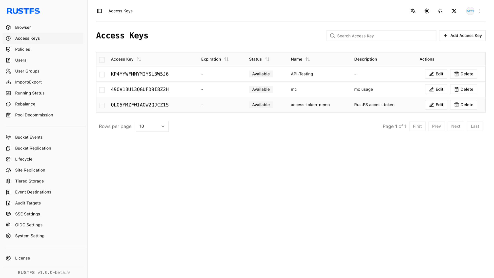
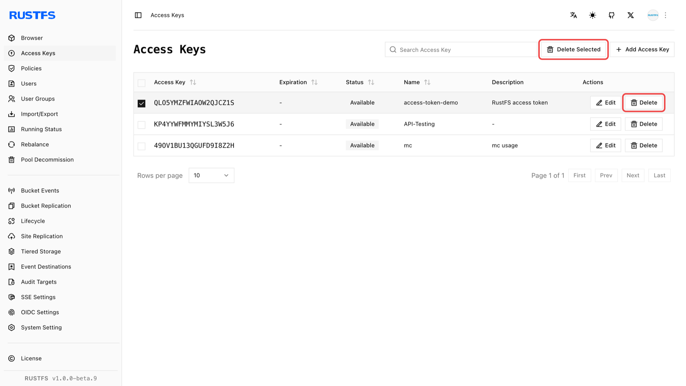

アクセスキーは、アプリケーションやツールが RustFS への認証とリクエストの認可に使う認証情報です。このページでは、Console でアクセスキーを作成および削除する方法を説明します。

## 前提条件

- 稼働中の RustFS インスタンス。手順は[インストールガイド](../../installation/index.md)を参照します。

## アクセスキーの作成

1. RustFS Console にサインインします。
2. 左のナビゲーションバーで **Access Keys**（アクセスキー）を選択します。
3. アクセスキーのページで、右上の **Add Access Key**（アクセスキーの追加）をクリックします。
4. キーの **Expiration**（有効期限）、**Name**（名前）、**Description**（説明）を入力し、**Submit**（送信）を選択します。
5. （推奨）表示されたページで **Copy**（コピー）または **Export**（エクスポート）を選択し、キーを保存します。

## アクセスキーの削除

1. RustFS Console にサインインします。
2. 左のナビゲーションバーで **Access Keys** を選択します。
3. アクセスキーのページで、削除するアクセスキーを選択します。
4. アクセスキーの横にある **Delete**（削除）を選択するか、右上の **Delete Selected Items**（選択項目の削除）を選択します。

