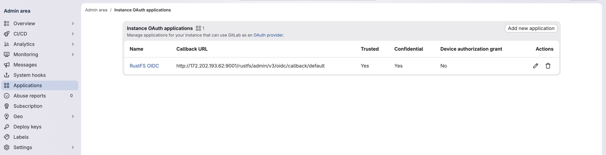
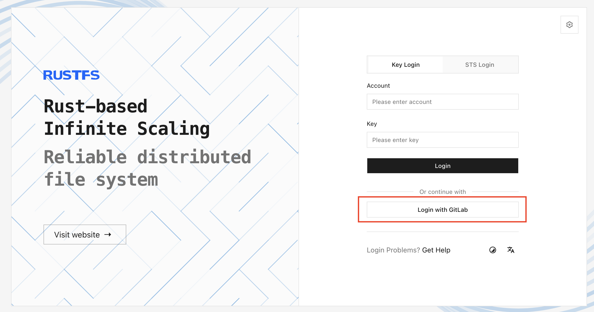

RustFS は、OpenID Connect（OIDC）の Authorization Code Flow を通じて **GitLab** と連携します。このページの例では、RustFS のデフォルトプロバイダー ID である `default` を使います。

## 要件

開始する前に、次を準備します。

- [インストール済みの GitLab インスタンス](https://about.gitlab.com/install/)と、その管理エリアへのアクセス。
- 公開 HTTPS の Console オリジンを持つ RustFS のデプロイ。
- GitLab ユーザーに割り当てる RustFS ポリシー。例では `consoleAdmin` を使います。本番では、ユーザーに必要な権限だけを持つポリシーを使います。

## 概要

ブラウザのログインの流れは次のとおりです。

1. RustFS は、Proof Key for Code Exchange（PKCE）の S256 チャレンジ付きで認可コードリクエストを送ります。
2. GitLab がユーザーを認証し、`code` と `state` を付けてブラウザを RustFS へリダイレクトします。
3. RustFS は、GitLab のトークンエンドポイントでコードを交換します。
4. RustFS は、ID トークンの署名、発行者、オーディエンス、有効期限、nonce を検証します。
5. RustFS は、設定されたローカルのアイデンティティとアクセス管理（IAM）ポリシーを割り当て、Console セッション用の一時認証情報を発行します。

GitLab がユーザーを認証し、RustFS のポリシーが S3 と管理操作を認可します。

例では次の値を使います。ホスト名とクライアントシークレットは、環境に合わせて置き換えます。

| 設定 | 例 |
| --- | --- |
| GitLab の発行者 | `https://gitlab.example.com` |
| GitLab のアプリケーション ID | `<gitlab-application-id>` |
| 公開する RustFS のオリジン | `https://rustfs.example.com` |
| RustFS のコールバック URL | `https://rustfs.example.com/rustfs/admin/v3/oidc/callback/default` |

## 設定

### GitLab の設定

#### OAuth アプリケーションを作成する

1. GitLab に管理者としてサインインします。
2. **Admin Area**（管理エリア）を開き、**Applications**（アプリケーション）を選択し、**New application**（新規アプリケーション）を選択します。
3. アプリケーション名として `RustFS OIDC` を入力します。
4. **Redirect URI**（リダイレクト URI）を、RustFS のコールバック URL に完全一致で設定します。

  ```text
  https://rustfs.example.com/rustfs/admin/v3/oidc/callback/default
  ```

5. **Confidential**（機密）を有効にします。
6. このインスタンス全体のアプリケーションでユーザー認可の確認を省略するため、**Trusted**（信頼済み）を有効にします。
7. `openid`、`profile`、`email` スコープを選択します。
8. アプリケーションを保存し、生成されたアプリケーション ID とシークレットをコピーします。

アプリケーション管理の詳細は、[GitLab の OAuth プロバイダーに関するドキュメント](https://docs.gitlab.com/integration/oauth_provider/)を参照します。



:::note[テスト環境の画面]

スクリーンショットは、テスト環境の HTTP コールバック URL を示しています。RustFS のデプロイでは、公開された HTTPS のコールバック URL を使います。

:::

### RustFS の設定

環境変数で GitLab プロバイダーを設定します。

#### 環境変数で設定する

GitLab プロバイダーと、ブラウザ向けの公開オリジンを、RustFS サービスの環境に追加します。

```ini title="/etc/default/rustfs"
RUSTFS_BROWSER_REDIRECT_URL="https://rustfs.example.com"

RUSTFS_IDENTITY_OPENID_ENABLE=on
RUSTFS_IDENTITY_OPENID_CONFIG_URL="https://gitlab.example.com"
RUSTFS_IDENTITY_OPENID_CLIENT_ID="<gitlab-application-id>"
RUSTFS_IDENTITY_OPENID_CLIENT_SECRET="<gitlab-application-secret>"
RUSTFS_IDENTITY_OPENID_SCOPES="openid,profile,email"
RUSTFS_IDENTITY_OPENID_REDIRECT_URI="https://rustfs.example.com/rustfs/admin/v3/oidc/callback/default"
RUSTFS_IDENTITY_OPENID_REDIRECT_URI_DYNAMIC=off
RUSTFS_IDENTITY_OPENID_DISPLAY_NAME="GitLab"
RUSTFS_IDENTITY_OPENID_EMAIL_CLAIM="email"
RUSTFS_IDENTITY_OPENID_USERNAME_CLAIM="preferred_username"
RUSTFS_IDENTITY_OPENID_ROLE_POLICY="consoleAdmin"
```

設定を適用したあと、RustFS を再起動します。

`RUSTFS_BROWSER_REDIRECT_URL` には、パスを除いた公開スキームとオーソリティを指定する必要があります。Console の成功時リダイレクトと、ログアウト時のフォールバック URL を制御します。プロバイダーのコールバック URL は、GitLab に登録した URL と完全に一致する必要があります。

:::warning[割り当てるポリシーを制限する]

`RUSTFS_IDENTITY_OPENID_ROLE_POLICY` は、このプロバイダー経由でサインインするすべてのユーザーに同じ RustFS ポリシーを割り当てます。`consoleAdmin` は、GitLab ユーザーに必要な権限だけを付与するポリシーに置き換えます。

:::

リバースプロキシまたはロードバランサーを使う場合は、コールバックのクエリ文字列を保持し、認可リクエストとコールバックリクエストを同じ RustFS ノードへルーティングします。処理中の OIDC `state` は、そのノードのローカルにあります。

## 確認

### GitLab のディスカバリーを確認する

GitLab のディスカバリードキュメントを問い合わせます。

```bash
curl -fsS "https://gitlab.example.com/.well-known/openid-configuration" | jq '{
  issuer,
  authorization_endpoint,
  token_endpoint,
  jwks_uri,
  scopes_supported,
  code_challenge_methods_supported
}'
```

次を確認します。

- `issuer` が `https://gitlab.example.com` であること。
- `authorization_endpoint`、`token_endpoint`、`jwks_uri` があること。
- `scopes_supported` に `openid`、`profile`、`email` が含まれること。
- `code_challenge_methods_supported` に `S256` が含まれること。

### RustFS のプロバイダーを確認する

RustFS を再起動したあと、プロバイダーが利用できることを確認します。

```bash
curl -fsS "https://rustfs.example.com/rustfs/admin/v3/oidc/providers" | jq
```

レスポンスには、表示名 `GitLab` の `default` プロバイダーが含まれるはずです。

### Console ログインを試す

RustFS Console を開き **GitLab** を選択するか、認可エンドポイントを直接開きます。

```text
https://rustfs.example.com/rustfs/admin/v3/oidc/authorize/default
```



一連の流れを確認します。

1. ブラウザが GitLab へリダイレクトされます。
2. ユーザーがサインインし、確認を求められたらアプリケーションを認可します。
3. GitLab が `code` と `state` を付けて RustFS のコールバック URL へリダイレクトします。
4. RustFS が ID トークンを検証し、Console セッションを作成します。
5. 設定した RustFS ポリシーで Console が開きます。

GitLab がリダイレクト URI の不一致を報告した場合は、GitLab アプリケーションに登録した URI が `RUSTFS_IDENTITY_OPENID_REDIRECT_URI` と完全に一致することを確認します。

## 次のステップ

- GitLab ユーザーに割り当てるポリシーを選ぶ前に、[ユーザー、グループ、ポリシー](../iam/policies.md)を確認します。
- ログインエンドポイントを公開する前に、[Console のセキュリティに関する注意](/ja/administration/console)を確認します。
