本页介绍按需迁移、开始前需要准备的内容，以及一次迁移实操。实操以 Cloudflare R2 作为示例。

## 1. 概述

按需迁移是入站拉取。客户端读取本地存储桶中不存在的对象键时，RustFS 从已配置的源读取该对象，返回给客户端，并写入本地。你也可以启动回填，拉取还没有客户端请求过的键。启用表单写明，RustFS 不会在源上写入或删除对象。迁移页写明，RustFS 中新的 `PUT` 和 `DELETE` 不会同步回源，源上之后的变更也不会更新已落本地的副本。按需迁移不是从源持续复制。

| 目标 | 使用 |
| --- | --- |
| 从下面列出的提供方把对象拉入 RustFS，在读取未命中时拉取，或通过回填拉取 | 按需迁移 |
| 把 RustFS 存储桶中的对象版本推到另一个存储桶 | [存储桶复制](./replication.md) |
| 在部署之间同步站点配置和身份数据 | [站点复制](/zh/operations/high-availability/site-replication) |

[存储桶复制](./replication.md)是对象版本的出站复制，并且要求源存储桶和目标存储桶都启用版本控制。对象键写入本地之后，按需迁移不会继续跟随源。

**Source connection** → **Provider** 列出这些源。下面的名称是控制台原文。Google Cloud Storage 有两项：HMAC 和 Native。

1. Amazon S3
2. S3-compatible storage
3. MinIO
4. RustFS
5. Cloudflare R2
6. Google Cloud Storage (HMAC)
7. Azure Blob Storage (Native)
8. Google Cloud Storage (Native)

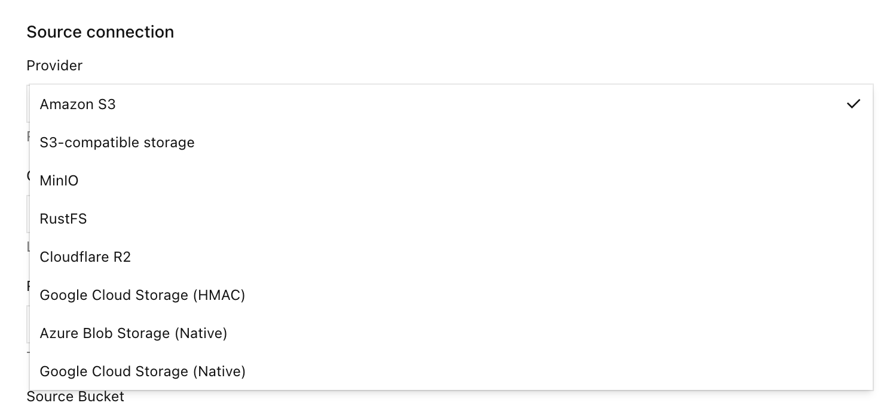

如果需要列表之外的提供方，请向 [RustFS 仓库](https://github.com/rustfs/rustfs) 提交拉取请求，以便官方审核。

:::warning[不要形成复制环路]
不要把已经是此本地存储桶复制目标的存储桶，再选成按需迁移的源。
:::

:::note[启用源不会开始搬数据]
**Migration active** 只表示存储桶已经挂上源。在客户端读到缺失的键，或你启动回填之前，运行时计数保持为 0。
:::

## 2. 要求

- 已安装的 RustFS 实例。按 [Linux 快速开始](/zh/installation/linux/quick-start) 安装 RustFS、登录控制台并创建存储桶。本次实操使用 Console v1.0.3，端口为 `9001`。
- 读取本地存储桶的主机上已安装 RustFS CLI [`rc`](/zh/operations/rc)。
- 一个用于本示例的 [Cloudflare R2](https://developers.cloudflare.com/r2/) 存储桶。

## 3. 迁移

本节以 **Cloudflare R2 作为示例**。从概述列表中的其他提供方迁移时，流程相同：创建空的本地存储桶，启用按需迁移，选择 **Provider**，选择 **Test connection**，选择 **Enable migration**，然后在 GET 未命中时拉取，或通过回填拉取。随提供方变化的只有端点、凭证和存储桶字段。

本页截图中的 R2 账户 ID 和访问密钥均已换成占位符。终端提示符中的主机是 `localhost`。

这里的凭证和端点属于 Cloudflare R2 示例。如果使用列表中的其他提供方，在同样的控制台字段中填写该系统的端点、只读凭证和存储桶名称。

- 控制台中有 **On-demand migration（按需迁移）**。本次实操使用 Console v1.0.3，端口为 `9001`。
- 控制台账号可以打开本地存储桶的 **Settings**。
- 读取本地存储桶的主机上已安装 RustFS CLI [`rc`](/zh/operations/rc)。
- 一个可以读取源存储桶对象的 Cloudflare R2 API 令牌。建议把令牌限制在该存储桶。此流程不使用 R2 存储桶的公共访问。
- 源存储桶的 R2 S3 端点 `https://<account-id>.r2.cloudflarestorage.com`。存储桶若使用管辖区，请从 R2 控制台复制端点。

把 `rc` 指向本地 RustFS 的 S3 API，不要指向 R2：

```bash
rc alias set rustfs http://localhost:9000 <your-access-key> <your-secret-key> --region us-east-1 --bucket-lookup path
```

本次实操的本地存储桶是 `migration`，R2 存储桶是 `dl-rustfs`。`migration` 已启用版本控制，对象锁定为关闭。启用按需迁移不需要对象锁定，这次也没有把版本控制当作启用条件。启用版本控制后，本地删除标记可以挡住源上的同名键。

:::warning[使用只读的源令牌]
创建只能读取源存储桶、不能在源上写入或删除的 R2 令牌。表单写明，RustFS 会保存秘密密钥，并且不会把它返回到控制台。
:::

### 1. 创建空的本地存储桶

在控制台打开 **Browser** → **Buckets**，创建名为 `migration` 的存储桶，并确认其中没有对象。准备挂源时，从该存储桶进入 **Settings**。

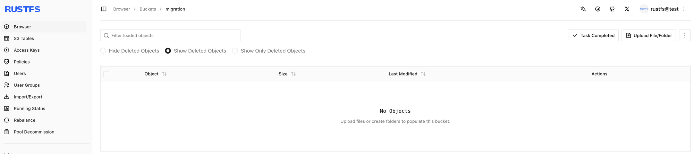

### 2. 打开按需迁移

1. 打开存储桶 `migration`，选择 **Settings**。
2. 选择 **Automation**。
3. 找到 **On-demand migration**。
4. 尚未配置时，选择 **Open migration settings** 或 **+ Enable on-demand migration**。已经启用时，选择 **Manage migration**。

本次实操中，未配置页面会说明还没有迁移源，并提供 **+ Enable on-demand migration**。

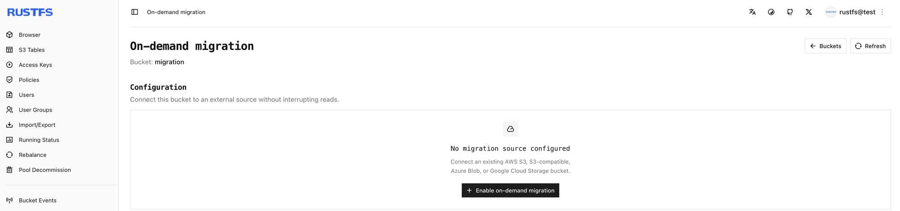

源启用之后，**Automation** 会显示 **Migration active** 和 **Manage migration**。

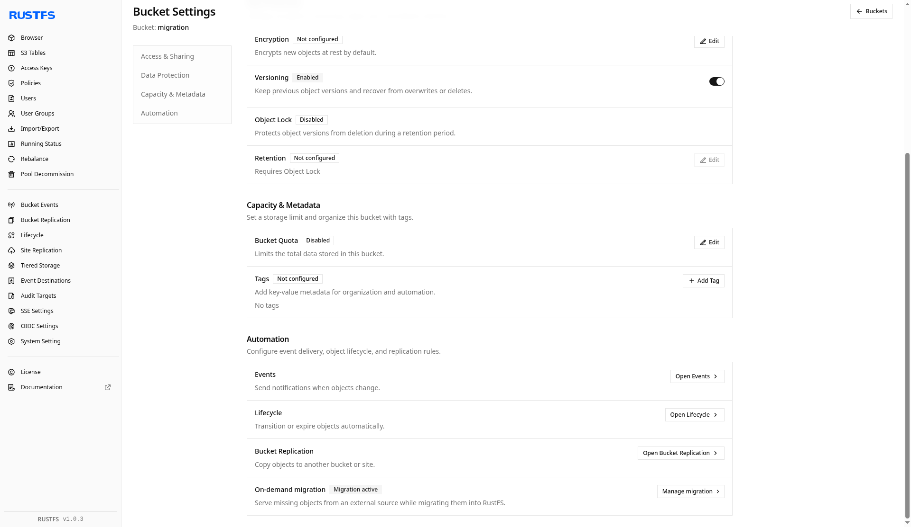

### 3. 把存储桶指向 Cloudflare R2

在 **Enable on-demand migration** 中按下面填写。把账户 ID 和密钥换成你自己的 R2 令牌。令牌不需要会话令牌时，会话令牌留空。**Local prefix** 留空即可暴露整个源命名空间。本次保存的配置没有额外前缀（**All keys**，**No added prefix**）。

| 字段 | 本次实操的值 |
| --- | --- |
| Source | Cloudflare R2 |
| Endpoint | `https://<account-id>.r2.cloudflarestorage.com` |
| Region | `us-east-1`（表单也接受 `auto`） |
| Source Bucket | `dl-rustfs` |
| Addressing style | Automatic |
| Access Key | R2 访问密钥 ID |
| Secret Key | R2 秘密密钥 |
| Session token | 空 |
| Local prefix | 空 |

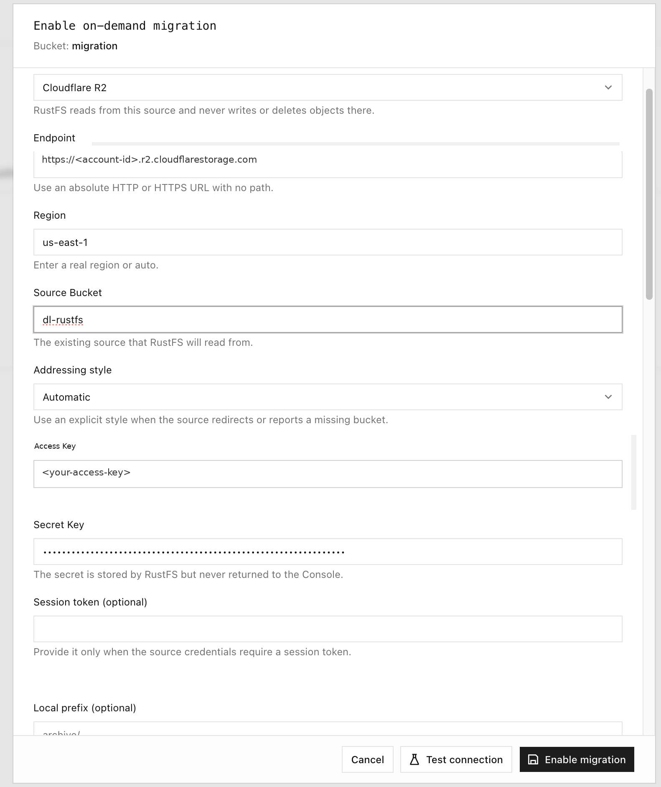

### 4. 测试连接并启用迁移

选择 **Test connection**。检查通过时显示 **Connection test passed**，并给出源存储桶中的一个样例对象键。然后选择 **Enable migration**。

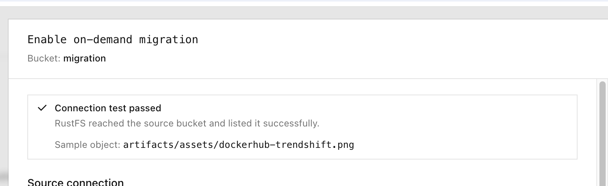

同一结果也会以 toast 出现：

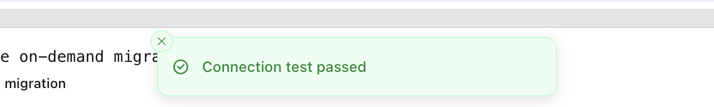

配置状态变为 **Migration active**。在发生读取或回填之前，**Runtime status** 中的已迁移对象和已迁移数据都为 0。**Latest job** 保持 **No backfill yet**。

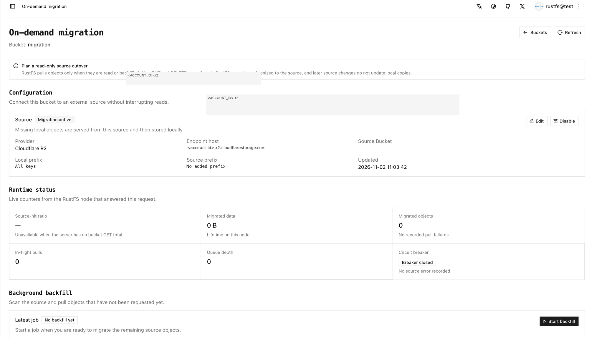

### 5. 用 rc cp 拉取单个对象

用 `rc` 读取本地存储桶。不要把这个请求发到 R2 端点。本次实操开始时本地存储桶仍为空，并拉取了一个缺失对象。第一次未命中会把对象返回给客户端，并写入本地。之后再读同一个键，由 RustFS 本地提供。

```bash
rc cp rustfs/migration/artifacts/rustfs/packages/nightly/rustfs-nightly-2026-11-02.deb /tmp/
```

```text
rustfs/migration/artifacts/rustfs/packages/nightly/rustfs-nightly-2026-11-02.deb -> /tmp/rustfs-nightly-2026-11-02.deb (71.34 MiB)
```

源存储桶中没有这个对象时，请改用你自己的键。终端记录了这次 `rc cp`，以及之后用 `rc ls` 查看本地 nightly 前缀。列表是对象已经在本地之后的前缀内容。上面这一条 `rc cp` 是 71.34 MiB 的单对象拉取。

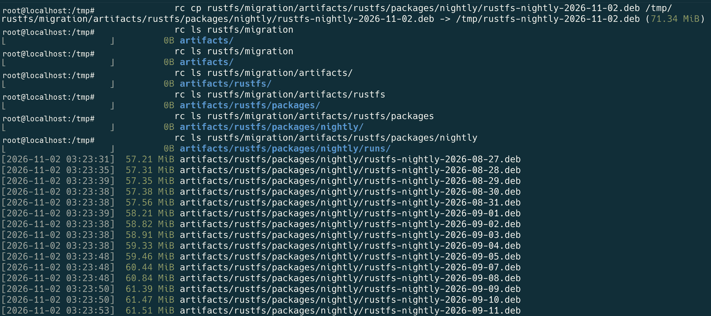

Cloudflare 控制台中，作为源的同一个 nightly 前缀：

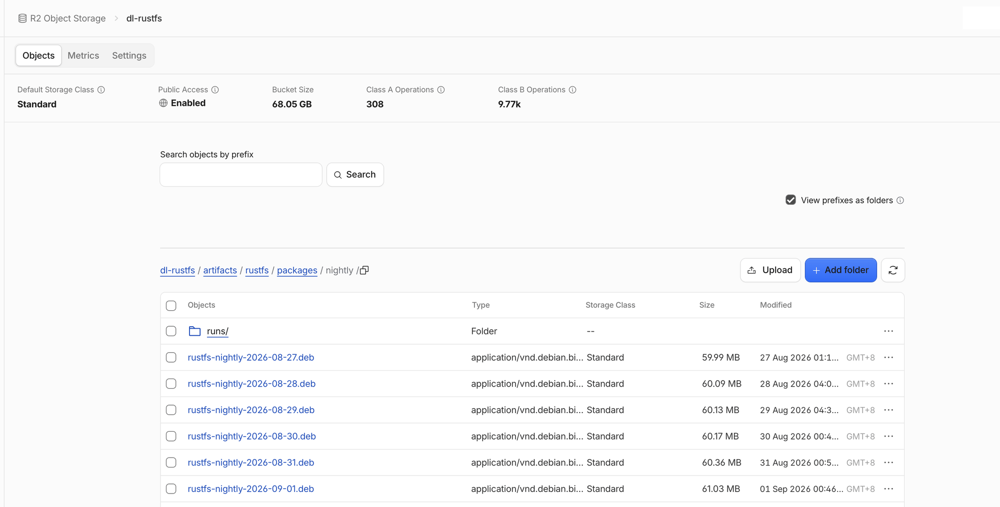

该控制台上的存储桶大小是 Cloudflare 统计的存储桶总量。本页后面的 RustFS 计数是这次迁移任务的结果。

单个对象拉取之后，控制台 **Browser** 会显示本地存储桶中的该对象：

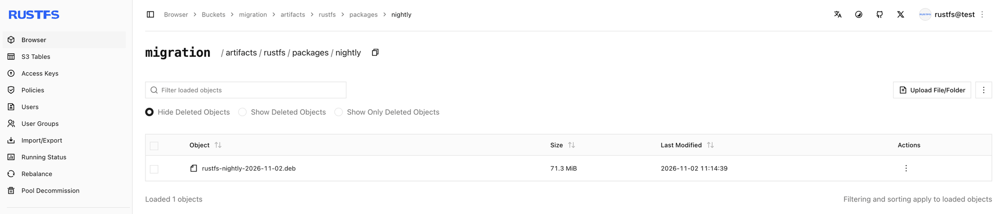

### 6. 按前缀回填

**Start backfill** 会扫描源，并拉取本地还没有的键。本次对话框使用了这些设置：

| 选项 | 含义 | 本次实操的值 |
| --- | --- | --- |
| Source listing prefix | 只列出该前缀 | `artifacts/rustfs/packages/nightly/` |
| Existing local objects | 键已在本地时如何处理 | **Always skip** |
| Dry run | 只列出匹配对象，不排队、不写入 | 演练时打开，正式拉取时关闭 |

**Dry run（试运行）** 只列出匹配对象，不排队也不写入任何对象。确认前缀后，先关闭 **Dry run** 再拉取。

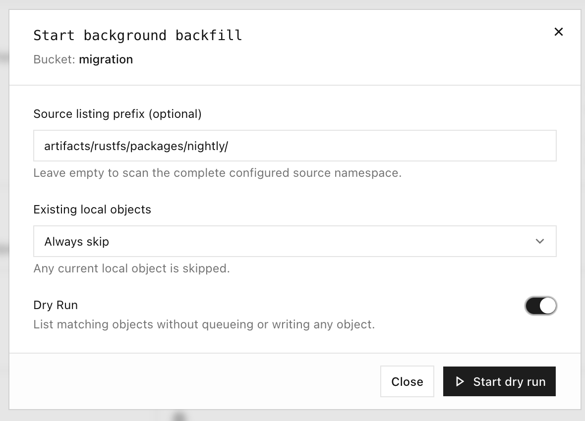

下面是实操中记录的前缀列表节选。实验室记录里第一行键被截断了，完整键的形式是 `artifacts/rustfs/packages/nightly/rustfs-nightly-2026-10-29.deb`。时间戳来自当时的记录，大约为 UTC。完整列表比这段节选更长。

```text
…ghtly-2026-10-29.deb
[2026-11-02 03:25:08]  70.36 MiB artifacts/rustfs/packages/nightly/rustfs-nightly-2026-10-30.deb
[2026-11-02 03:25:08]  70.65 MiB artifacts/rustfs/packages/nightly/rustfs-nightly-2026-10-31.deb
[2026-11-02 03:25:08]  71.15 MiB artifacts/rustfs/packages/nightly/rustfs-nightly-2026-11-01.deb
[2026-11-02 03:14:39]  71.34 MiB artifacts/rustfs/packages/nightly/rustfs-nightly-2026-11-02.deb
[2026-11-02 03:25:08]  71.34 MiB artifacts/rustfs/packages/nightly/rustfs-nightly-latest.deb
```

回填正在写入对象时，控制台会显示已列出和已拉取的数量。源仍在扫描时，不显示完成百分比。

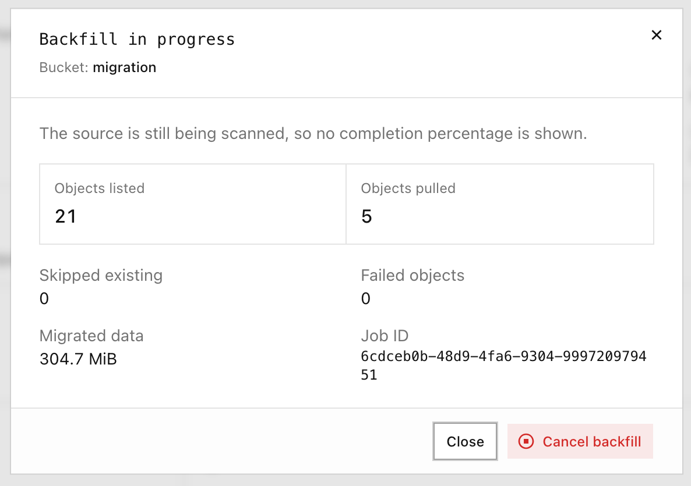

### 7. 先试运行，再回填源命名空间

**Source listing prefix** 留空，即扫描已配置的源命名空间。先做 **Dry run**，确认列出的范围，再关闭 **Dry run** 并启动回填。

这次实操中的一次试运行只列出了对象，没有拉取：

| Listed | Pulled | Skipped | Failed objects | Data |
| --- | --- | --- | --- | --- |
| 128 | 0 | 0 | 0 | 0 B |

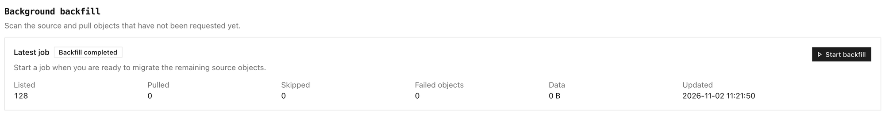

随后以前缀为空做的全量回填结果如下：

| Listed | Pulled | Skipped | Failed objects | Data |
| --- | --- | --- | --- | --- |
| 128 | 127 | 1 | 0 | 8.0 GiB |

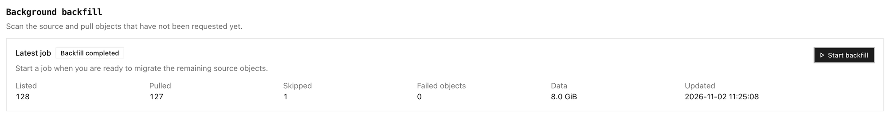

### 8. 验证存储桶

在按需迁移页面检查：

1. **Runtime status** — 已迁移对象和已迁移数据不再为 0，并且没有记录到拉取失败。
2. **Background backfill** — 最近一次任务显示列出、拉取、跳过和失败的数量。
3. **Browser** 和 `rc` — 像上面的终端记录那样用 `rc ls` 列出前缀，再用 `rc cp` 重新读取一个已在本地的键。

本次运行时面板显示 **Migrated data** 为 8.1 GiB，**Migrated objects** 为 128。最近一次回填为 Listed 128、Pulled 127、Skipped 1、Failed objects 0、Data 8.0 GiB。

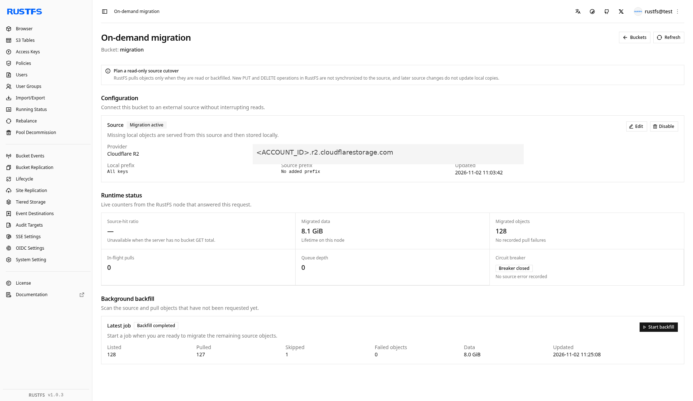

实操结束后的存储桶列表中，`migration` 为 128 个对象、8.1 GiB：

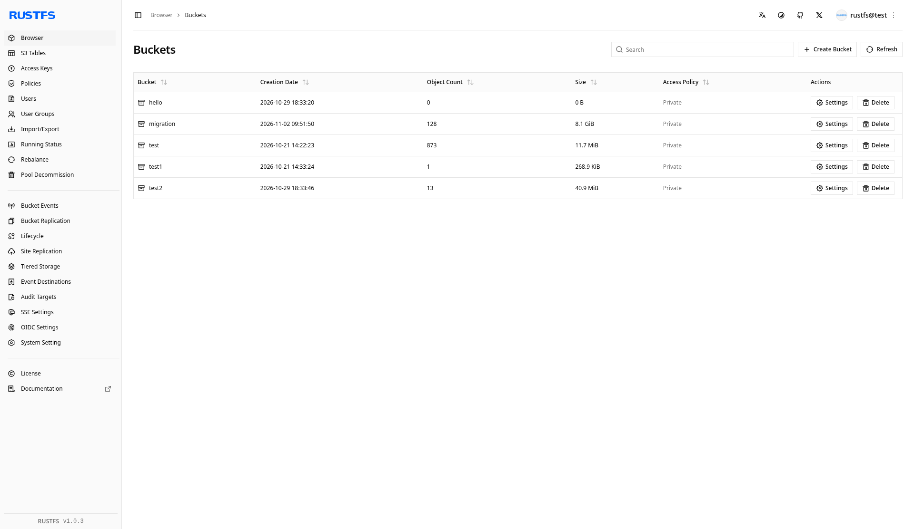

:::warning[本地副本不会跟随源]
R2 上同名键之后的变更不会覆盖本地对象。对该键的本地 `PUT` 不会写回源，并且会挡在源键前面。按需迁移不是从源持续复制。
:::

### 后续步骤

- 需要出站副本时，[配置存储桶复制](./replication.md)
- [安装并使用 rc](/zh/operations/rc)
- 需要同步站点配置和身份数据时，[配置站点复制](/zh/operations/high-availability/site-replication)
