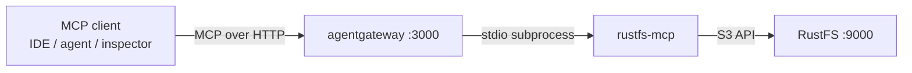
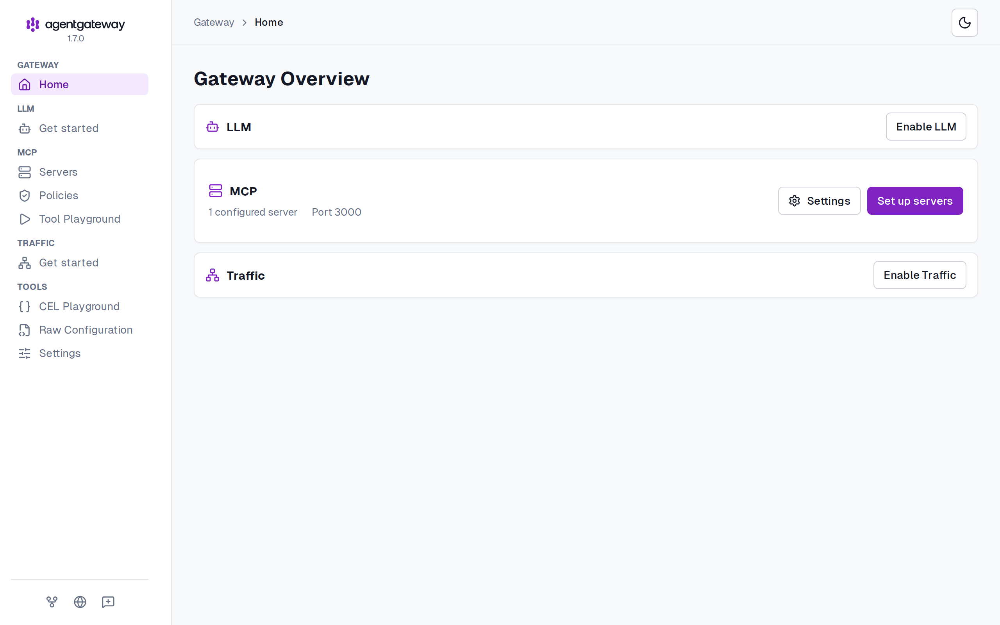
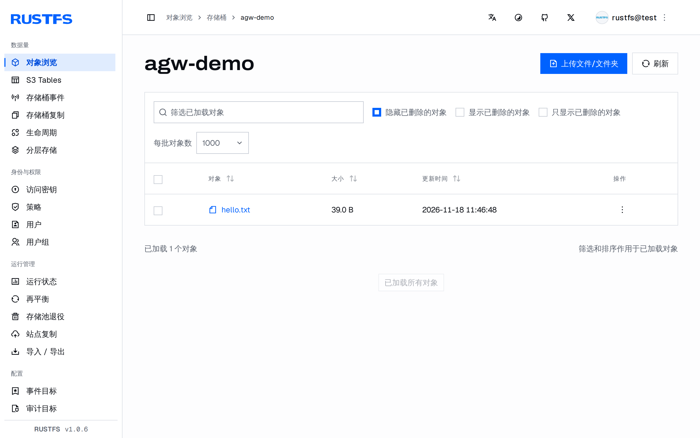

[agentgateway](https://github.com/agentgateway/agentgateway) 是面向 MCP、A2A 和 LLM 流量的 AI 原生代理。它的 MCP 网关可以联邦多个 MCP server 并通过网络暴露，附带认证、策略和 OpenTelemetry 可观测性。[RustFS 自带 MCP server](https://github.com/rustfs/mcp)，把存储操作暴露为工具，但只有 stdio 传输——只能作为本地子进程使用，无法远程访问。本指南把两者连接起来：agentgateway 以 stdio target 拉起 RustFS MCP server，并将其作为远程 MCP 端点提供服务，任何 MCP 客户端都能通过网关操作 RustFS 存储。整个流程在 agentgateway `1.7.0`、`rustfs/mcp` server 与 RustFS `1.0.6` 上验证通过。

你需要网关宿主机上的 Docker 和一台可达的 RustFS 服务器。

## 架构



网关把 `rustfs-mcp` 作为子进程拉起，并在其 stdio 传输与 3000 端口的 MCP Streamable HTTP 监听之间做转换。存储操作流经网关，因此网关的策略、限流和遥测同样作用于对象存储工具调用。

:::note[为什么 stdio server 需要网关]

stdio MCP server 只能被启动它的那台机器访问。agentgateway 补上了缺失的传输层——远程客户端通过 HTTP 连接，而 S3 凭证留在网关宿主机上。

:::

## 1. 构建 RustFS MCP server 镜像

MCP server 在独立仓库中。从源码构建镜像：

```bash
git clone https://github.com/rustfs/mcp.git rustfs-mcp
docker build -t rustfs/rustfs-mcp:latest rustfs-mcp
```

构建出的镜像以 stdio 方式运行 MCP server，并通过标准 `AWS_*` 环境变量连接任意 S3 兼容端点。

## 2. 配置 agentgateway

创建网关配置。target 以子进程方式启动 MCP 镜像；卷挂载为上传工具暴露宿主机目录，端点经由 Docker bridge 网关地址指向 RustFS：

```yaml title="config.yaml"
mcp:
  port: 3000
  targets:
  - name: rustfs
    stdio:
      cmd: docker
      args:
      - run
      - --rm
      - -i
      - -v
      - /data/agentgateway/demo:/demo
      - -e
      - AWS_ACCESS_KEY_ID=<your-access-key>
      - -e
      - AWS_SECRET_ACCESS_KEY=<your-secret-key>
      - -e
      - AWS_REGION=us-east-1
      - -e
      - AWS_ENDPOINT_URL=http://172.17.0.1:9000
      - rustfs/rustfs-mcp:latest
```

:::note[MCP 容器内的端点寻址]

MCP server 运行在容器里，RustFS 宿主机上的 `127.0.0.1:9000` 对它不可达。使用 Docker bridge 网关地址 `172.17.0.1:9000`（或共享网络别名）。如果 RustFS 本身也跑在自定义 bridge 网络的 Docker 里，Docker 会隔离不同 bridge——把两个容器接入同一网络并使用容器名。

:::

以配置内容启动网关：

```bash
agentgateway -c "$(cat config.yaml)"
```

日志会确认各监听器：3000 端口的 MCP bind、`http://localhost:15000/ui` 的管理 UI，以及 15020 的 stats 端点。



## 3. 通过网关调用 RustFS 工具

MCP inspector 可驱动网关做人工验证：

```bash
npx @modelcontextprotocol/inspector --cli http://localhost:3000/mcp --method tools/list
```

```json
"tools": ["create_bucket", "delete_bucket", "get_object", "list_buckets", "list_objects", "upload_file"]
```

通过网关创建桶并上传文件：

```bash
npx @modelcontextprotocol/inspector --cli http://localhost:3000/mcp \
  --method tools/call --tool-name create_bucket \
  --tool-arg bucket_name=agw-demo

npx @modelcontextprotocol/inspector --cli http://localhost:3000/mcp \
  --method tools/call --tool-name upload_file \
  --tool-arg local_file_path=/demo/hello.txt \
  --tool-arg bucket_name=agw-demo --tool-arg object_key=hello.txt
```

```text
✅ **File uploaded successfully!**
```

:::note[上传路径在 MCP server 一侧]

`upload_file` 读取的是运行 MCP server 的进程所在文件系统中的 `local_file_path`——也就是容器内部。第 2 步的卷挂载 `-v /data/agentgateway/demo:/demo` 把宿主机目录暴露为容器内的 `/demo`，工具因此能读到文件。

:::

## 4. 在 RustFS 中确认对象

经网关写入的对象和普通 S3 写入一样落桶。用 S3 API 确认，替换全部连接占位符：

```bash
aws s3api list-objects --bucket agw-demo \
  --endpoint-url http://localhost:9000
```

```json
{
    "Contents": [
        {
            "Key": "hello.txt",
            "Size": 39,
            "StorageClass": "STANDARD"
        }
    ]
}
```

再经网关读回，完成闭环：

```bash
npx @modelcontextprotocol/inspector --cli http://localhost:3000/mcp \
  --method tools/call --tool-name get_object \
  --tool-arg bucket_name=agw-demo --tool-arg object_key=hello.txt --tool-arg mode=read
```

    Content: hello from rustfs-mcp via agentgateway



## 验证结果

| 检查项 | 预期结果 |
| --- | --- |
| 经网关的 MCP 握手 | `serverInfo.name` 返回 `rustfs-mcp-server`，协议 `2025-03-26` |
| `tools/list` | 六个存储工具全部联邦：`create_bucket`、`delete_bucket`、`get_object`、`list_buckets`、`list_objects`、`upload_file` |
| 经网关 `create_bucket` | 桶出现在 RustFS |
| 经网关 `upload_file` | 对象落桶；控制台与 S3 API 均可见 |
| 经网关 `get_object` | 内容与上传文件逐字节一致 |
| 网关管理 UI | 正确显示已配置的 MCP server 与端口 |

## 故障排查

### `Error: invalid config: invalid type: string "config.yaml"`

config 参数接收的是配置内容而非路径。传文件内容：`agentgateway -c "$(cat config.yaml)"`。

### MCP 工具超时或报连接错误

MCP 容器到不了 RustFS 地址。容器内的 `127.0.0.1:9000` 是容器自身——使用 `172.17.0.1:9000`（Docker bridge 网关）或共享网络别名，见第 2 步。

### `upload_file` 报本地文件不存在

路径在 MCP server 容器内解析。用 `-v` 把宿主机目录挂进容器并引用挂载路径，见第 2 步。

### `GET /mcp` 返回 `406 Not Acceptable`

预期行为：Streamable HTTP 端点只接受带 `Accept: application/json, text/event-stream` 头的 `POST` 请求——请使用 inspector 等 MCP 客户端，不要用浏览器。

## 下一步

- 查阅 [RustFS MCP server](/developer/mcp) 参考了解完整工具集。
- 使用[访问密钥管理](/security-compliance/iam/access-token)为网关身份创建专用凭证。
- 按照 [agentgateway 文档](https://agentgateway.dev/docs/)在同一网关上使用认证策略、限流与 OpenTelemetry。
