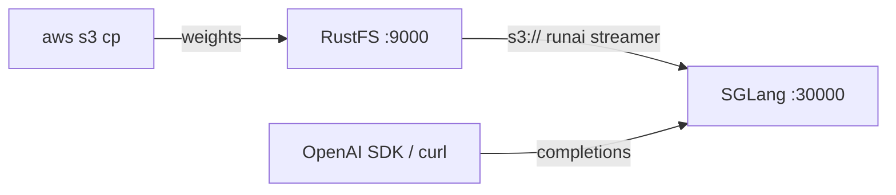
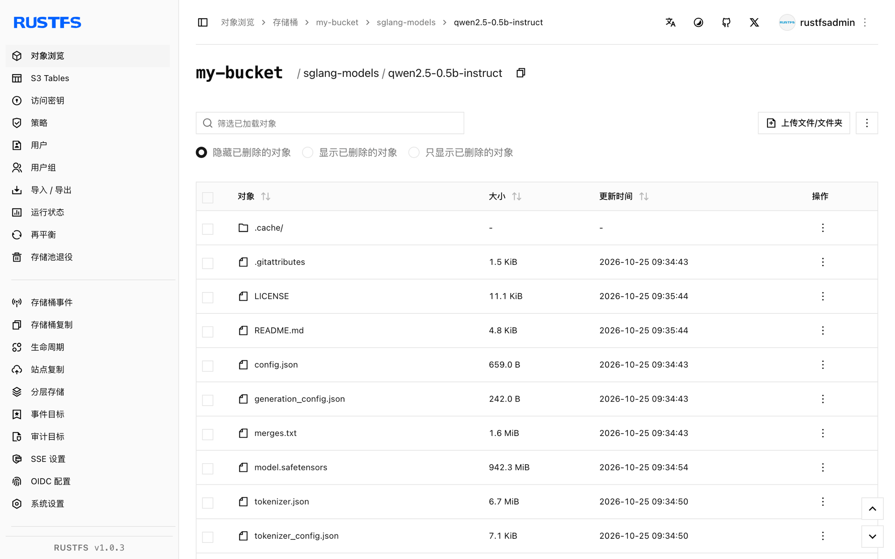

本指南将高性能大模型服务框架 [SGLang](https://github.com/sgl-project/sglang) 连接到 **RustFS** 作为其模型权重存储。你将把模型上传到 RustFS 桶，让 SGLang 直接读取 `s3://` 路径，权重从桶中流式加载并提供 OpenAI 兼容请求。整个流程使用 `lmsysorg/sglang:v0.5.22-xeon`（SGLang 0.5.22，CPU 引擎）在纯 CPU 主机上对 `Qwen/Qwen2.5-0.5B-Instruct` 验证通过。

你需要 Docker 以及一个小型 Hugging Face 模型。本部署用于本地集成测试，不适用于生产环境。

## 架构



当 `--model-path` 是对象存储 URI 时，SGLang 自动切换到 `runai_streamer` 加载格式：元数据文件（`config.json`、tokenizer）先下载到本地缓存，随后权重张量在引擎加载时惰性流入。桶内始终是模型的唯一副本，服务节点无需本地模型库。

:::note[CPU 镜像不带 S3 流式加载器]

`xeon` CPU 镜像不包含 `runai-model-streamer-s3`，直接用 `s3://` 模型路径启动会报 `ImportError: S3 files module not found`。启动服务前需要在容器内安装该包——镜像的虚拟环境由 `uv` 管理，没有 `pip` 模块。

:::

## 1. 上传模型到 RustFS

从 Hugging Face 获取模型文件并拷入桶，替换全部连接占位符：

```bash
docker run --rm -v "$PWD/models:/models" --entrypoint python3 \
  lmsysorg/sglang:v0.5.22-xeon -c \
  'from huggingface_hub import snapshot_download; snapshot_download("Qwen/Qwen2.5-0.5B-Instruct", local_dir="/models/qwen2.5-0.5b-instruct")'

aws s3 cp models/qwen2.5-0.5b-instruct \
  s3://my-bucket/sglang-models/qwen2.5-0.5b-instruct --recursive \
  --endpoint-url http://<your-rustfs-endpoint>:9000 \
  --acl private
```

为后续命令导出凭证：

```bash
export AWS_ACCESS_KEY_ID=<your-access-key>
export AWS_SECRET_ACCESS_KEY=<your-secret-key>
export AWS_DEFAULT_REGION=us-east-1
```

每个模型使用一个独立前缀，多个模型即可共用同一个桶。流式加载器仅读取 `.safetensors` 格式的权重文件。

## 2. 启动 SGLang 指向桶

运行 CPU 镜像，安装 S3 流式加载包，然后启动服务指向桶 URI：

```bash
docker run -d --name sglang -p 30000:30000 \
  -e AWS_ACCESS_KEY_ID \
  -e AWS_SECRET_ACCESS_KEY \
  -e AWS_DEFAULT_REGION \
  -e AWS_ENDPOINT_URL=http://<your-rustfs-endpoint>:9000 \
  --entrypoint bash lmsysorg/sglang:v0.5.22-xeon -c \
  'uv pip install -q runai-model-streamer-s3 && \
   python3 -m sglang.launch_server \
     --model-path s3://my-bucket/sglang-models/qwen2.5-0.5b-instruct \
     --served-model-name qwen2.5-0.5b-instruct \
     --host 0.0.0.0 --port 30000 \
     --device cpu --trust-remote-code \
     --disable-overlap-schedule \
     --mem-fraction-static 0.45'
```

`AWS_ENDPOINT_URL` 把流式加载器指向 RustFS；对自定义端点的请求使用路径样式寻址。`--mem-fraction-static` 决定 CPU 后端上 KV cache 占用主机内存的比例——空闲内存更多的主机可以调高。等待启动完成：

```bash
docker logs -f sglang
```

```text
The server is fired up and ready to roll!
```

## 3. 运行推理

确认模型已提供服务，然后发送 OpenAI 兼容的补全请求：

```bash
curl -s http://localhost:30000/v1/models
```

```json
{"object":"list","data":[{"id":"qwen2.5-0.5b-instruct","object":"model","owned_by":"sglang","root":"qwen2.5-0.5b-instruct","max_model_len":32768}]}
```

```bash
curl -s http://localhost:30000/v1/completions \
  -H "Content-Type: application/json" \
  -d '{"model":"qwen2.5-0.5b-instruct","prompt":"RustFS is","max_tokens":16,"temperature":0}'
```

```json
{"object":"text_completion","model":"qwen2.5-0.5b-instruct","choices":[{"index":0,"text":" a file system for the Linux kernel that is designed to be used in embedded systems","finish_reason":"length"}],"usage":{"prompt_tokens":4,"total_tokens":20,"completion_tokens":16}}
```



## 4. 停止或重置

保留桶内对象并拆除演示环境：

```bash
docker rm -f sglang
```

删除已存储的模型：

```bash
aws s3 rm s3://my-bucket/sglang-models --recursive \
  --endpoint-url http://<your-rustfs-endpoint>:9000
```

## 故障排查

### `ImportError: S3 files module not found`

runai 流式加载器的 S3 后端缺失。按第 2 步所示，在启动服务前于容器内执行 `uv pip install runai-model-streamer-s3`。

### `pip: command not found` 或 `No module named pip`

镜像中的 `/opt/.venv` 由 `uv` 创建且未内置 `pip`。请使用 `uv pip install` 而不是 `pip install`。

### `Loaded weights leave no GPU memory for the KV cache`

`--mem-fraction-static` 相对当前主机加载的权重来说过小。错误信息会给出最低可行值——用更大的比例重启服务（例如 16 GB 主机上的 0.5 B 模型取 `0.45`）。

### 请求报签名或访问错误

确认服务容器的四个变量都已设置：`AWS_ACCESS_KEY_ID`、`AWS_SECRET_ACCESS_KEY`、`AWS_DEFAULT_REGION`，以及带协议前缀的 `AWS_ENDPOINT_URL`。

## 下一步

- 在启用更多服务操作前，先阅读 [S3 兼容性说明](/administration/protocols/s3)。
- 使用[访问密钥管理](/security-compliance/iam/access-token)创建专用的生产凭证。
- 按照 [SGLang 文档](https://docs.sglang.io/)在同一个桶支撑的模型库之上使用张量并行、量化与更大的模型。
