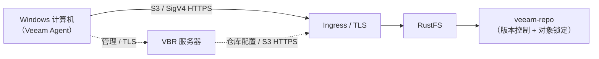
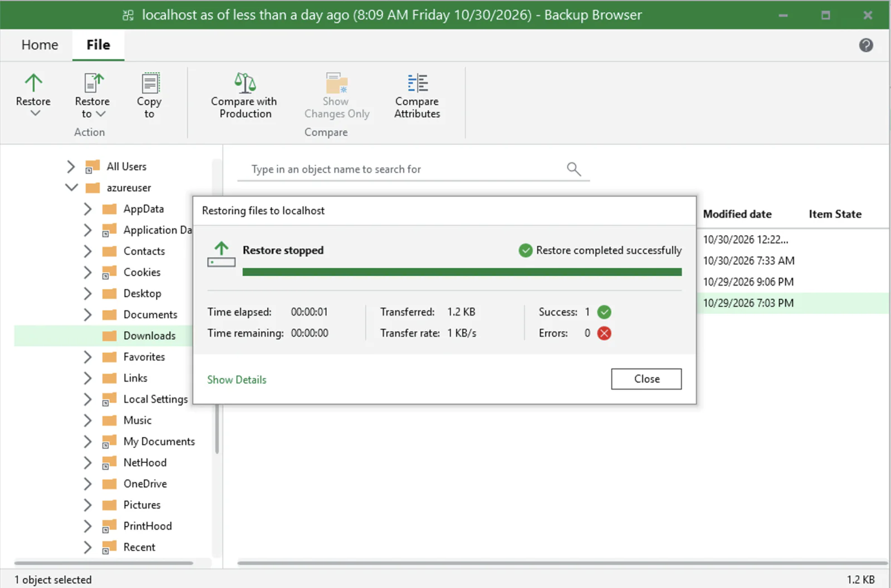

Veeam Backup & Replication（VBR）是一个企业级备份平台，可将备份数据存储在 S3 兼容的对象存储中。本页演示如何将 RustFS 注册为 VBR 对象存储仓库、使用 Veeam Agent 备份整台 Windows 计算机，并从备份中恢复文件。

你需要一个可以通过 HTTPS 访问的 RustFS 实例、一个专用于备份的存储桶、一台安装了 VBR 13 的 Windows 机器，以及包含对象存储备份功能的 Veeam 许可证。请从 [Veeam 官方下载页面](https://www.veeam.com/products/downloads.html) 下载 VBR，并按 [Veeam 系统要求](https://helpcenter.veeam.com/docs/vbr/userguide/system_requirements_backup_server.html?ver=13) 配置备份服务器，不要将小型实验虚拟机的配置视为正式部署要求。

:::note[许可证要求]

备份到 S3 兼容对象存储是 Veeam 的企业级功能。生产使用需购买 Veeam Enterprise 版许可证，或其他包含该功能的付费许可证。概念验证（POC）可[申请免费的 30 天 Veeam Data Platform 试用许可证](https://www.veeam.com/products/data-platform-trial.html)，并在运行作业前安装。仅下载或安装 VBR 不会启用该功能。在已验证配置中，Community Edition 可以添加仓库，但未安装所需许可证时无法运行对象存储备份作业。

:::

## 已验证配置

作者报告的测试使用 VBR **13.1.2.57**、RustFS **1.0.1**、Windows Agent 备份和 **Direct** 连接模式的仓库，完成了备份作业及一次文件级恢复。这是集成测试，不是 Veeam 认证，也未验证裸机恢复、保留期强制执行或全部 Veeam 工作负载。测试中观察到的约 1 MiB 对象不是固定块大小承诺。

## 架构



Direct 模式下，Agent 将备份数据发送至 RustFS，VBR 管理作业和仓库。网关模式则通过指定的网关或挂载服务器传输数据。实际传输数据的 Agent 或网关必须能够访问并信任 RustFS HTTPS 端点。参见 [Veeam Agent 连接模式](https://helpcenter.veeam.com/docs/vbr/userguide/agents_object_storage.html?ver=13)。本页使用的对象键前缀为 `veeam`，存储桶为 `veeam-repo`。

## 1. 准备存储桶和凭据

创建启用版本控制和对象锁定的专用存储桶。版本控制是 Veeam 不可变备份所依赖的对象锁定的前提：

```bash
rc bucket create <your-alias>/veeam-repo --with-lock
rc bucket version info <your-alias>/veeam-repo
```

以下是限定到该存储桶的初始策略，需结合所选 Veeam 模式验证。存储桶操作与对象操作使用不同资源范围。存储桶已存在，因此省略 `s3:CreateBucket`。这不是已经证明的最小权限策略：实验策略包含法律保留管理及绕过治理模式保留期的权限。生产使用前应审核并移除不必要的权限。尤其是 `s3:BypassGovernanceRetention` 允许绕过治理模式保护，不能假定持有此凭据的客户端无法删除受保护版本。

```json
{
  "Version": "2012-10-17",
  "Statement": [
    {
      "Effect": "Allow",
      "Action": ["s3:GetObject","s3:PutObject","s3:DeleteObject",
                 "s3:GetObjectVersion","s3:DeleteObjectVersion",
                 "s3:AbortMultipartUpload","s3:ListMultipartUploadParts",
                 "s3:PutObjectRetention","s3:GetObjectRetention",
                 "s3:PutObjectLegalHold","s3:GetObjectLegalHold",
                 "s3:BypassGovernanceRetention"],
      "Resource": ["arn:aws:s3:::veeam-repo/*"]
    },
    {
      "Effect": "Allow",
      "Action": ["s3:ListBucket","s3:ListBucketVersions","s3:GetBucketLocation",
                 "s3:GetBucketVersioning","s3:GetBucketObjectLockConfiguration",
                 "s3:ListBucketMultipartUploads"],
      "Resource": ["arn:aws:s3:::veeam-repo"]
    }
  ]
}
```

```bash
rc admin policy create <your-alias> veeam-repo-rw <path-to-policy-file>
rc admin user add <your-alias> veeam <your-secret-key>
rc admin policy attach <your-alias> veeam-repo-rw --user veeam
```

Veeam 要求 S3 兼容对象存储通过 HTTPS 访问。可使用 Traefik 或 Nginx 在 RustFS 前终结 TLS。证书 SAN 必须覆盖端点主机名，证书链必须被 VBR 服务器及实际传输数据的 Agent 或网关信任。使用私有 CA 时，将其根 CA 证书安装到相应受信任根证书存储区；不要把任意端点证书当作可信 CA 导入，也不要关闭验证。

不要在这个专用备份桶配置生命周期过期或迁移规则，应由 Veeam 管理备份保留期。参见 [Veeam Agent 对象存储限制](https://helpcenter.veeam.com/docs/agentforwindows/userguide/backup_to_object_storage.html)。

## 2. 在 VBR 中添加 RustFS 仓库

在 VBR 控制台中，进入 **Backup Infrastructure → Backup Repositories → Add Repository → Object storage → S3 Compatible**：

1. Service point：你的 RustFS HTTPS 端点，Region：`us-east-1`。
2. Credentials：`veeam` 访问密钥和秘密密钥。图示数据路径使用 **Direct**；不适合直接访问时选择网关。
3. Bucket：`veeam-repo`，Folder：`veeam`。
4. 新桶没有前缀时，先用 S3 客户端在 `veeam/` 下创建一个对象，再用 **Browse** 选择 Folder。
5. 测试不可变备份时，启用 **Make backups immutable** 并单独验证对象保留期。仅在桶上启用对象锁定，不代表每份备份都不可变。


当 Veeam 提示自动创建存储桶因 Access Denied 失败时，选择 **Yes** 禁用该功能并继续——存储桶已经存在，且 IAM 用户有意无法创建存储桶。

Agent 备份还需按 [Veeam S3 兼容仓库访问说明](https://helpcenter.veeam.com/docs/vbr/userguide/access_permissions.html?ver=13) 配置 **Set Access Permissions → Security**。**Provided by the backup server** 通过网关或挂载服务器传输，即使仓库显示 Direct。真正的 Direct 访问需要兼容的 IAM/STS 配置，或 **Agents share credentials to object storage repository**。后者会把仓库凭据交给受保护机器，安全性较低，仅在隔离 POC 中按需使用。通用 IAM/STS 支持不等于兼容 Veeam 凭据流程，生产使用前必须验证所选模式。

实验记录未说明 Security 的选项，因此不能独立证明数据未经过网关。

成功后，仓库以 **S3-compatible** 类型列出。Used Space 是 Veeam 报告的用量，并非独立的 RustFS 容量测量：


## 3. 登记受保护的计算机

仅创建备份作业不会安装 Veeam Agent。请使用保护组：

1. **Inventory → Physical and Cloud Infrastructure → Add protection group…**
2. 类型选择 **Individual computers**，使用真实主机名和 `HOSTNAME\user` 形式的本地管理员凭据添加机器。
3. 保持 **Install Veeam Backup & Replication Agent** 勾选，然后 Apply。

:::warning[Windows UAC 远程限制]

先检查主机名、凭据、连通性和防火墙。只有确认原因是本地账户 UAC 远程令牌过滤时，管理员才应考虑将 `HKLM\SOFTWARE\Microsoft\Windows\CurrentVersion\Policies\System` 下的 `LocalAccountTokenFilterPolicy` 设为 `1`。这会允许本地管理员获得提升权限的远程令牌，不是通用的访问被拒修复。应限制到可信管理网络、记录原值，在不再需要时恢复并检查 Agent 管理仍正常。参见 [Microsoft UAC 远程限制](https://learn.microsoft.com/en-us/troubleshoot/windows-server/windows-security/user-account-control-and-remote-restriction)。安装后，Backup agent 列显示 **Reboot required** 时重启机器。

:::

## 4. 运行备份作业

1. **Home → Backup Job → Windows computer…**
2. Computers：**From protection group**，Backup Mode：**Entire computer**。
3. Storage：Backup repository = **RustFS**，保留策略按需设置。
4. Finish 后，右键作业选择 **Start**。

作业完成后，作业列表显示 **Last Result: Success**，还原点出现在 **Home → Backups → Object Storage → RustFS Veeam Backup** 下：


验证 RustFS 中的对象：

```bash
rc object find <your-alias>/veeam-repo/ | tail -1
```

测试在 `Veeam/Backup/veeam/Clients/{agent-id}/…` 下观察到数据对象。仅列出对象不能证明备份完整、还原点可用或已设置不可变保留期。

## 5. 恢复文件

1. **Home → Backups → Object Storage → RustFS Veeam Backup → <computer>**。
2. 右键还原点 → **Restore guest files…** → Browse。
3. 在 Backup Browser 中选择一个文件，将其恢复到目标文件夹，并核对内容。



恢复成功且内容一致，验证的是该文件的备份至文件恢复流程，不代表所有还原点均可恢复。不可变备份 POC 还应检查保留模式和到期时间，并用受控测试数据验证保留期内无法删除受保护版本；不要对生产备份执行破坏性检查。

## 故障排查

| 现象 | 处理方法 |
|---|---|
| "Backup to object storage requires a valid Enterprise edition license" | 安装包含对象存储功能的许可证（试用或付费）；Community Edition 无法运行对象存储作业 |
| 作业报 "backup agent is missing" | 通过保护组登记机器（步骤 3）；作业向导不会推送安装 Agent |
| Agent 推送失败并报访问被拒 | 先检查凭据、主机名和防火墙；仅在确认是远程过滤问题时参考上方 UAC 警告 |
| Backup agent 列显示 "Reboot required" | 重启机器以完成 Agent 安装 |
| 控制台在开机后显示 HTTP 502 | Veeam 服务仍在启动；待 `VeeamBackupSvc` 和 PostgreSQL 服务处于 Running 后重试 |
| 向导中 Folder 列表为空 | Folder 选择器只列出现有前缀；先在前缀下创建一个占位对象，再 Browse |
| 仓库容量显示 N/A | SOSAPI 报告并非备份所必需；支持情况见 [rustfs/rustfs#1511](https://github.com/rustfs/rustfs/issues/1511) |

## 后续步骤

- [Veeam 官方下载](https://www.veeam.com/products/downloads.html)和 [POC 试用许可证](https://www.veeam.com/products/data-platform-trial.html)。
- [Veeam Agent 对象存储要求](https://helpcenter.veeam.com/docs/agentforwindows/userguide/backup_to_object_storage.html)。
- [RustFS 对象锁定](../../../administration/data/object/object-lock.md)和[存储桶版本控制](../../../administration/data/object/versioning.md)。
