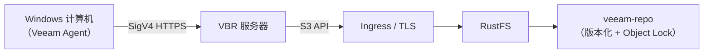
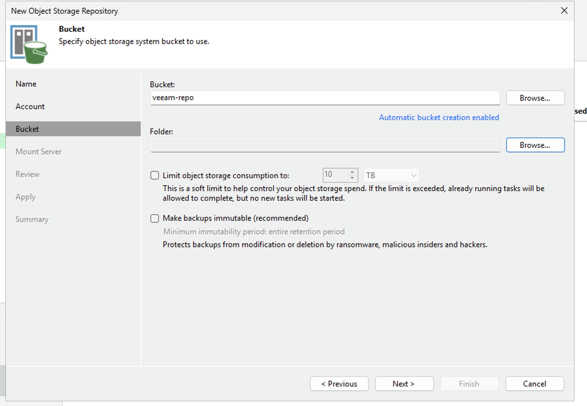
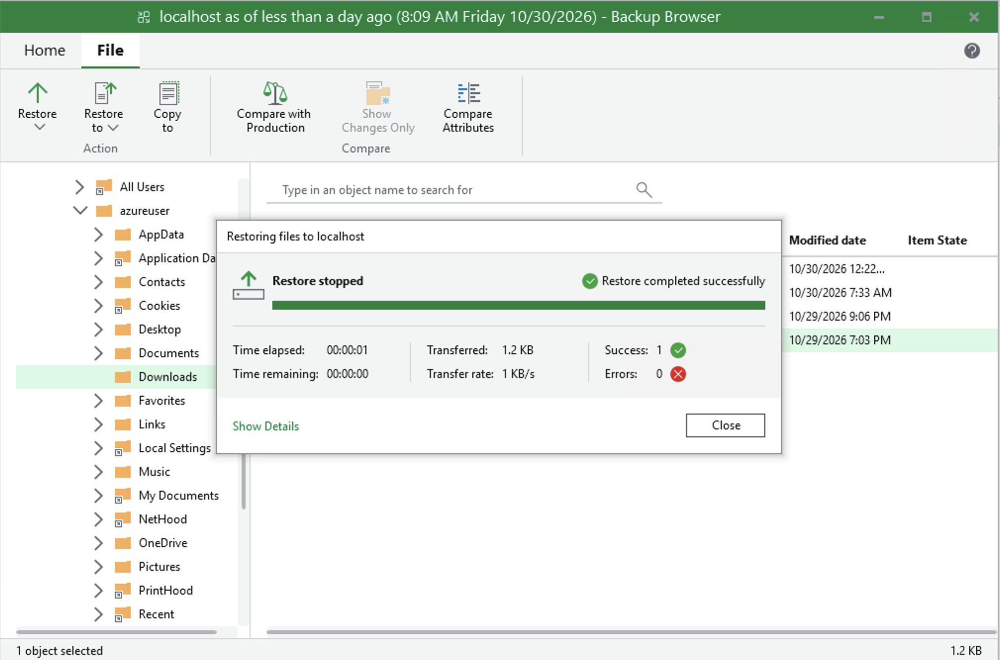

Veeam Backup & Replication（VBR）是一个企业级备份平台，可将备份数据存储在 S3 兼容的对象存储中。本页演示如何将 RustFS 注册为 VBR 对象存储仓库、使用 Veeam Agent 备份整台 Windows 计算机，并从备份中恢复文件。

你需要一个可以通过 HTTPS 访问的 RustFS 实例、一个专用于备份的存储桶、一台安装了 VBR 13 的 Windows 机器（实践上至少 4 vCPU、8 GB 内存），以及一个包含对象存储备份功能的 Veeam 许可证。

:::note[许可证要求]

备份到对象存储是 Veeam 的 Enterprise 层级功能。VBR Community Edition 可以添加并校验 S3 仓库，但向其运行备份作业需要 Enterprise 许可证或免费的 30 天评估密钥（Veeam Data Platform Trial Key）。

:::

## 架构



备份期间，Veeam 通过 S3 API 将约 1 MiB 的备份块写入存储桶；恢复时只读回包含请求数据的块。本页使用的桶前缀为 `veeam`，存储桶为 `veeam-repo`。

## 1. 准备存储桶和凭据

创建一个启用版本化和 Object Lock 的专用存储桶。版本化是 Veeam 不可变备份所依赖的 Object Lock 的前提：

```bash
rc bucket create <your-alias>/veeam-repo --with-lock
rc bucket version info <your-alias>/veeam-repo
```

创建一个仅限该存储桶的最小权限策略。该策略有意省略了 `s3:CreateBucket`：Veeam 会提供自动创建存储桶的功能，当存储桶已经存在时，拒绝该功能是推荐的做法。

```json
{
  "Version": "2012-10-17",
  "Statement": [
    {
      "Effect": "Allow",
      "Action": ["s3:GetObject","s3:PutObject","s3:DeleteObject",
                 "s3:GetObjectVersion","s3:DeleteObjectVersion",
                 "s3:AbortMultipartUpload","s3:ListMultipartUploadParts",
                 "s3:ListBucketMultipartUploads",
                 "s3:PutObjectRetention","s3:GetObjectRetention",
                 "s3:PutObjectLegalHold","s3:GetObjectLegalHold",
                 "s3:BypassGovernanceRetention"],
      "Resource": ["arn:aws:s3:::veeam-repo/*"]
    },
    {
      "Effect": "Allow",
      "Action": ["s3:ListBucket","s3:ListBucketVersions","s3:GetBucketLocation",
                 "s3:GetBucketVersioning"],
      "Resource": ["arn:aws:s3:::veeam-repo"]
    }
  ]
}
```

```bash
rc admin policy create <your-alias> veeam-repo-rw <path-to-policy-file>
rc admin user add <your-alias> veeam <your-secret-key>
rc admin policy attach <your-alias> veeam-repo-rw --user veeam
```

Veeam 要求对象存储通过 HTTPS 访问。在 RustFS 前面终结 TLS（例如使用 Traefik 或 Nginx），证书的 SAN 需覆盖端点主机名，并将该证书导入 Veeam 服务器的**受信任的根证书颁发机构**存储区。

## 2. 在 VBR 中添加 RustFS 仓库

在 VBR 控制台中，进入 **Backup Infrastructure → Backup Repositories → Add Repository → Object storage → S3 Compatible**：

1. Service point：你的 RustFS HTTPS 端点，Region：`us-east-1`。
2. Credentials：`veeam` 访问密钥和秘密密钥。
3. Bucket：`veeam-repo`，Folder：`veeam`。
4. 可选：启用 **Make backups immutable**（存储桶的 Object Lock 已启用）。



当 Veeam 提示自动创建存储桶因 Access Denied 失败时，选择 **Yes** 禁用该功能并继续——存储桶已经存在，且 IAM 用户有意无法创建存储桶。

成功后，仓库将以 **S3-compatible** 类型列出，已用空间与存储桶内容一致：


## 3. 登记受保护的计算机

仅创建备份作业不会安装 Veeam Agent。请使用保护组：

1. **Inventory → Physical and Cloud Infrastructure → Add protection group…**
2. 类型选择 **Individual computers**，使用真实主机名和 `HOSTNAME\user` 形式的本地管理员凭据添加机器。
3. 保持 **Install Veeam Backup & Replication Agent** 勾选，然后 Apply。

:::note[Windows UAC]

如果 Agent 推送失败并报访问错误，请在目标机器上将 `HKLM\SOFTWARE\Microsoft\Windows\CurrentVersion\Policies\System` 下的 `LocalAccountTokenFilterPolicy` 设置为 `1` 并重新扫描。Agent 安装完成后，当 Backup agent 列显示 **Reboot required** 时，重启该机器。

:::

## 4. 运行备份作业

1. **Home → Backup Job → Windows computer…**
2. Computers：**From protection group**，Backup Mode：**Entire computer**。
3. Storage：Backup repository = **RustFS**，保留策略按需设置。
4. Finish 后，右键作业选择 **Start**。

作业完成后，作业列表显示 **Last Result: Success**，还原点出现在 **Home → Backups → Object Storage → RustFS Veeam Backup** 下：


验证 RustFS 中的对象：

```bash
rc object find <your-alias>/veeam-repo/ | tail -1
```

Veeam 将约 1 MiB 的数据块存储在 `Veeam/Backup/veeam/Clients/{agent-id}/…` 下，每个对象都带有 ETag 和版本。

## 5. 恢复文件

1. **Home → Backups → Object Storage → RustFS Veeam Backup → <computer>**。
2. 右键还原点 → **Restore guest files…** → Browse。
3. 在 Backup Browser 中选择一个文件，将其恢复到目标文件夹，并核对内容。



恢复只会读回包含所选文件的块，这也验证了针对 RustFS 的完整读取路径。

## 故障排查

| 现象 | 处理方法 |
|---|---|
| "Backup to object storage requires a valid Enterprise edition license" | 安装包含对象存储功能的许可证（试用或付费）；Community Edition 无法运行对象存储作业 |
| 作业报 "backup agent is missing" | 通过保护组登记机器（步骤 3）；作业向导不会推送安装 Agent |
| Agent 推送失败并报访问被拒 | 在目标机器设置 `LocalAccountTokenFilterPolicy=1`；使用真实主机名，不要用 `localhost` |
| Backup agent 列显示 "Reboot required" | 重启机器以完成 Agent 安装 |
| 控制台在开机后显示 HTTP 502 | Veeam 服务仍在启动；待 `VeeamBackupSvc` 和 PostgreSQL 服务处于 Running 后重试 |
| 向导中 Folder 列表为空 | Folder 选择器只列出现有前缀；先在前缀下创建一个占位对象，再 Browse |
| 仓库容量显示 N/A | SOSAPI 报告并非备份所必需；支持情况见 [rustfs#1511](https://github.com/rustfs/rustfs/issues/1511) |
