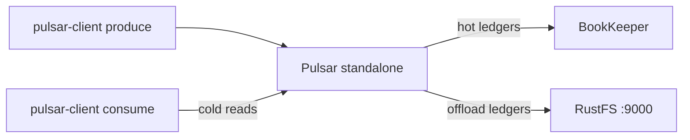
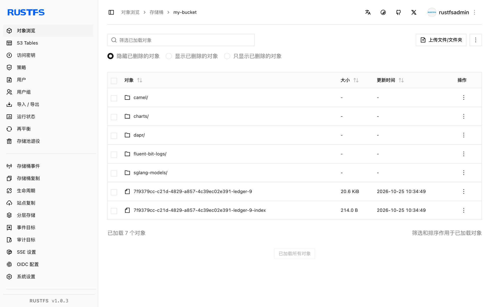

本指南将 [Apache Pulsar](https://github.com/apache/pulsar) 通过其分层存储 S3 offloader 连接到 **RustFS**。你将运行一个 standalone broker 并把卸载指向 RustFS 桶，生产消息、触发 ledger 卸载，再从桶中把卸载的消息读回来。整个流程使用 `apachepulsar/pulsar-all:4.0.4` 把 topic 卸载到 RustFS 并从中冷读验证通过。

你需要 Docker。本部署用于本地集成测试，不适用于生产环境。

## 架构



旧 ledger 以 `<offloader-id>-ledger-<n>` 数据块加一个小体积 `-index` 对象的形式上传到桶。当消费者请求的消息已不在 BookKeeper 时，broker 会透明地从桶中读回。

## 1. 启动带卸载的 standalone broker

基础镜像 `apachepulsar/pulsar` 不带 offloader 包，启动会报 `No offloader found for driver 'S3'`——请使用包含它们的 `pulsar-all` 镜像。broker 的堆内存做了上限约束：

```bash
docker run -d --name pulsar -p 6650:6650 -p 8080:8080 \
  -e ACCESS_KEY_ID=<your-access-key> \
  -e ACCESS_KEY_SECRET=<your-secret-key> \
  -e PULSAR_MEM="-Xms512m -Xmx512m" \
  --entrypoint bash apachepulsar/pulsar-all:4.0.4 -c '
    sed -i -e "s|^managedLedgerMaxEntriesPerLedger=.*|managedLedgerMaxEntriesPerLedger=100|" \
           -e "s|^managedLedgerMinLedgerRolloverTimeMinutes=.*|managedLedgerMinLedgerRolloverTimeMinutes=1|" \
           /pulsar/conf/standalone.conf
    printf "\nmanagedLedgerOffloadDriver=S3\nmanagedLedgerOffloadBucket=my-bucket\nmanagedLedgerOffloadServiceEndpoint=http://<your-rustfs-endpoint>:9000\nmanagedLedgerOffloadRegion=us-east-1\n" >> /pulsar/conf/standalone.conf
    exec bin/pulsar standalone -nss
  '
```

两条 `managedLedger*` 修改把 ledger 调小，让演示内就能完成滚动；追加的配置块启用卸载。

:::note[驱动 S3 读取 managedLedgerOffload* 键，而不是 s3ManagedLedgerOffload*]

对驱动 `S3`，offloader 解析的是通用键 `managedLedgerOffloadBucket`、`managedLedgerOffloadServiceEndpoint`、`managedLedgerOffloadRegion`。`s3ManagedLedgerOffload*` 名字属于 `aws-s3` 驱动，在这里会被忽略——用了它们，offloader 会以 `NullPointerException: endpoint` 崩溃。凭证同理：驱动 `S3` 读取环境变量 `ACCESS_KEY_ID` 和 `ACCESS_KEY_SECRET`，不是 `AWS_*` 这对。

:::

等待 broker 就绪：

```bash
docker logs -f pulsar 2>&1 | grep -m1 "The ledger offloader was created"
```

## 2. 生产消息并保活 topic

没有订阅的 topic 会在几分钟内被 inactive-topic 清理删除，演示会中途作废。先生产一批消息，然后创建一个持久订阅保住 topic：

```bash
docker exec pulsar bin/pulsar-client produce -m "hello rustfs offload" -n 300 \
  persistent://public/default/rustfs-test
```

```text
300 messages successfully produced
```

```bash
timeout 30 docker exec pulsar bin/pulsar-client consume -s keepalive -n 1 -p Earliest \
  persistent://public/default/rustfs-test
```

## 3. 滚动 ledger 并触发卸载

只有当 `managedLedgerMinLedgerRolloverTimeMinutes` 到期后仍有写入时 ledger 才会滚动——检查发生在写入时，不是后台。等满一分钟，再生产一批迫使滚动，然后把最后一 KB 之前的所有数据卸载：

```bash
sleep 65
docker exec pulsar bin/pulsar-client produce -m "rollover" -n 120 \
  persistent://public/default/rustfs-test
docker exec pulsar bin/pulsar-admin topics offload -s 1K \
  persistent://public/default/rustfs-test
```

```text
Offload triggered for persistent://public/default/rustfs-test for messages before 11:0:-1
```

卸载需要一点时间——等待完成：

```bash
sleep 30
docker exec pulsar bin/pulsar-admin topics offload-status \
  persistent://public/default/rustfs-test
```

```text
Offload was a success
```

确认 ledger 对象已落在 RustFS——数据块加索引，位于桶根：

```bash
aws s3 ls s3://my-bucket/ --recursive \
  --endpoint-url http://<your-rustfs-endpoint>:9000 | grep ledger
```

```text
2026-10-25 02:34:49      21057 7f9379cc-c21d-4829-a857-4c39ec02e391-ledger-9
2026-10-25 02:34:49        214 7f9379cc-c21d-4829-a857-4c39ec02e391-ledger-9-index
```

## 4. 冷读卸载的消息

用全新订阅从最早位置消费。第一个 ledger 现在只存在于 RustFS 中，broker 返回的每条消息都是一次从桶的冷读：

```bash
timeout 90 docker exec pulsar bin/pulsar-client consume -s coldread -n 420 -p Earliest \
  persistent://public/default/rustfs-test 2>&1 | grep -c "^-----"
```

```text
420
```

420 条消息——卸载 ledger 的 300 条加上活跃 ledger 的 120 条——全部经桶读回。



## 5. 停止或重置

保留桶内对象并拆除 broker：

```bash
docker rm -f pulsar
```

删除已卸载的 ledger：

```bash
aws s3 rm s3://my-bucket/ --recursive --exclude "*" --include "*ledger*" \
  --endpoint-url http://<your-rustfs-endpoint>:9000
```

## 故障排查

### `No offloader found for driver 'S3'. Please make sure you dropped the offloader nar packages`

镜像里没有 offloader NAR。按第 1 步使用 `apachepulsar/pulsar-all`。

### 卸载时报 `NullPointerException: endpoint`

offloader 没有读到 service endpoint——`managedLedgerOffload*` 键缺失，或写成了 `aws-s3` 驱动的 `s3ManagedLedgerOffload*` 名字。按第 1 步追加配置块并重启。

### broker 日志出现 `Couldn't get the access key id.`

驱动 `S3` 不读 `AWS_ACCESS_KEY_ID`。在 broker 容器上导出 `ACCESS_KEY_ID` 和 `ACCESS_KEY_SECRET`。

### 演示中途出现 `Topic ... not found`

inactive-topic 清理把没有订阅的 topic 删了。重跑第 2 步，并保持 `keepalive` 订阅存在。

### 显示 `Offload was a success` 但桶里没有对象

只有早于大小阈值且已关闭的 ledger 会被上传，而 ledger 在超过最小滚动年龄后的下一次写入时才滚动。再生产一批，然后重新触发卸载。

## 下一步

- 在 namespace 上启用自动卸载阈值前，先阅读 [S3 兼容性说明](/administration/protocols/s3)。
- 使用[访问密钥管理](/security-compliance/iam/access-token)创建专用的生产凭证。
- 按照 [Pulsar 分层存储文档](https://pulsar.apache.org/docs/next/cookbooks-tiered-storage/)在同一个桶上使用 namespace 阈值、保留策略与多节点 broker。
