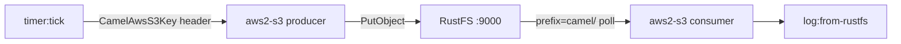
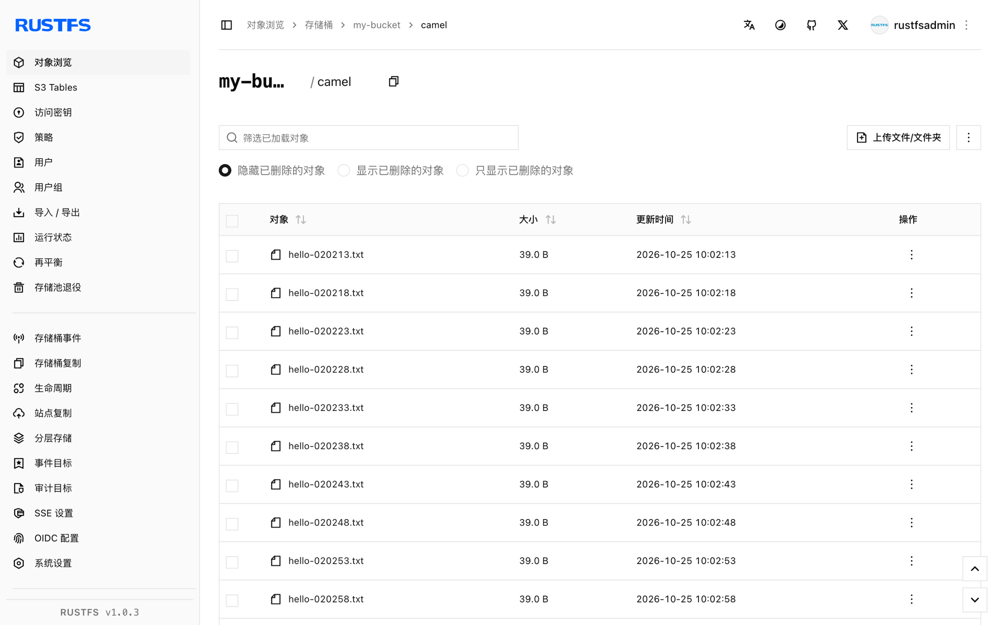

本指南将多面手集成框架 [Apache Camel](https://github.com/apache/camel) 通过其 S3 组件连接到 **RustFS**。你将用 YAML 编写两条路由：定时把消息写入桶的生产者路由，以及读回这些对象并记录日志的消费者路由。整个流程使用 Camel JBang（`eclipse-temurin:21-jdk` 镜像）和 `aws2-s3` 组件（覆写端点 + 路径样式寻址）验证通过。

你需要 Docker。本部署用于本地集成测试，不适用于生产环境。

## 架构



Camel JBang 直接运行路由文件并自动解析 S3 组件依赖——无需项目脚手架、构建或部署步骤。

## 1. 编写集成路由

创建路由文件。凭证来自默认 AWS 凭证链（环境变量），URI 中只携带寻址信息：

```yaml title="route.yaml"
- from:
    uri: "timer:tick"
    parameters:
      period: "5000"
    steps:
      - setBody:
          simple: "Hello from Camel at ${date:now:yyyy-MM-dd HH:mm:ss}"
      - setHeader:
          name: "CamelAwsS3Key"
          simple: "camel/hello-${date:now:HHmmss}.txt"
      - to:
          uri: "aws2-s3://my-bucket?overrideEndpoint=true&uriEndpointOverride=http://<your-rustfs-endpoint>:9000&forcePathStyle=true&useDefaultCredentialsProvider=true"
- from:
    uri: "aws2-s3://my-bucket?prefix=camel/&deleteAfterRead=false&maxMessagesPerPoll=5&overrideEndpoint=true&uriEndpointOverride=http://<your-rustfs-endpoint>:9000&forcePathStyle=true&useDefaultCredentialsProvider=true"
    steps:
      - to:
          uri: "log:from-rustfs"
```

生产者通过 `CamelAwsS3Key` 头设置对象 key——这里是每条消息一个时间戳，因此每次触发都会写入一个新对象。消费者以 `deleteAfterRead=false` 轮询 `camel/` 前缀，对象消费后仍保留在桶中。

:::note[组件名与端点参数]

本工作流中 Camel JBang 解析到的组件是 `aws2-s3`。`overrideEndpoint=true` 激活自定义端点，`uriEndpointOverride` 携带其 URL，`forcePathStyle=true` 选择 RustFS 期望的路径样式寻址，`useDefaultCredentialsProvider=true` 让组件从标准环境变量读取凭证。

:::

## 2. 用 Camel JBang 运行路由

在导出凭证的容器中运行集成。JBang 首次使用会请求信任来源，先加好信任规则再启动：

```bash
docker run --rm --network bridge \
  -e AWS_ACCESS_KEY_ID=<your-access-key> \
  -e AWS_SECRET_ACCESS_KEY=<your-secret-key> \
  -e AWS_REGION=us-east-1 \
  -v "$PWD:/routes" \
  --entrypoint bash eclipse-temurin:21-jdk -c '
    export JBANG_DIR=/root/.jbang PATH=/root/.jbang/bin:$PATH
    curl -Ls https://sh.jbang.dev | bash >/dev/null 2>&1
    jbang trust add https://github.com/apache/ 2>/dev/null || true
    jbang trust add /routes 2>/dev/null || true
    cd /routes && jbang camel@apache/camel run route.yaml
  '
```

首次运行会下载 Camel 运行时与依赖，然后启动路由。消费者每读到一个对象就输出一条日志：

```text
2026-10-25 02:02:41.069  INFO 120 --- [-s3://my-bucket] from-rustfs : Exchange[ExchangePattern: InOnly, BodyType: byte[], Body: Hello from Camel at 2026-10-25 02:02:38]
```

## 3. 验证对象

确认生产者写入的对象已在 RustFS 中，替换全部连接占位符：

```bash
aws s3 ls s3://my-bucket/camel/ \
  --endpoint-url http://<your-rustfs-endpoint>:9000
```

```text
2026-10-25 02:02:13         39 hello-020213.txt
2026-10-25 02:02:18         39 hello-020218.txt
2026-10-25 02:02:23         39 hello-020223.txt
```



## 4. 停止或重置

停止容器即结束路由。删除演示对象：

```bash
aws s3 rm s3://my-bucket/camel --recursive \
  --endpoint-url http://<your-rustfs-endpoint>:9000
```

## 故障排查

### `Cannot find component with name: aws-s3`

你的 Camel 版本以别的名字解析组件——本工作流用的是 `aws2-s3`。以运行时建议列表（`Did you mean: ... aws2-s3 ...`）里的名字为准。

### `is not from a trusted source`

JBang 拒绝运行不受信任的代码。按第 2 步先执行 `jbang trust add https://github.com/apache/` 和 `jbang trust add /routes` 再运行。

### `useDefaultCredentialsProvider is set to false`

组件没有在 URI 中找到凭证配置。要么加 `useDefaultCredentialsProvider=true` 并导出 `AWS_ACCESS_KEY_ID` 和 `AWS_SECRET_ACCESS_KEY`，要么直接配置 `accessKey`、`secretKey` 端点参数。

### 消费者读不到数据

消费者只轮询 `prefix=camel/` 给出的前缀。确认生产者已运行（有 `timer` 日志），且其 `CamelAwsS3Key` 头以 `camel/` 开头。

## 下一步

- 在采用分段或流式操作前，先阅读 [S3 兼容性说明](/administration/protocols/s3)。
- 使用[访问密钥管理](/security-compliance/iam/access-token)创建专用的生产凭证。
- 按照 [Camel S3 组件文档](https://camel.apache.org/components/latest/aws2-s3-component.html)在相同路由上使用下载区间、桶操作与消费者调优。
