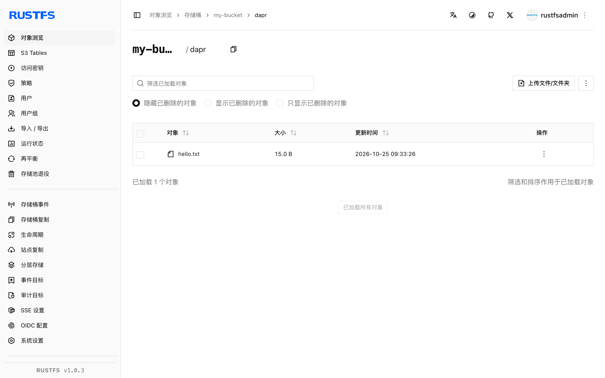

本指南将 CNCF 的分布式应用运行时 [Dapr](https://github.com/dapr/dapr) 通过其 AWS S3 binding 连接到 **RustFS**。你将声明一个以 RustFS 桶为后端的 binding 组件，运行 sidecar，并用 binding 的 HTTP API 创建对象、读回并独立确认。整个流程使用 `daprio/dapr:1.19.0` 以路径样式寻址对 RustFS 桶验证通过。

你需要 Docker。本部署用于本地集成测试，不适用于生产环境。

## 架构


应用不持有任何 S3 凭证或端点。sidecar 把桶暴露为命名 binding，每个操作都是一次对 binding 端点的 POST，携带 `operation` 与可选 `metadata`。

## 1. 声明 binding 组件

创建组件文件。`endpoint` 带协议前缀，`forcePathStyle` 对齐 RustFS 的路径样式寻址：

```yaml title="rustfs-s3.yaml"
apiVersion: dapr.io/v1alpha1
kind: Component
metadata:
  name: rustfs-s3
spec:
  type: bindings.aws.s3
  version: v1
  metadata:
  - name: bucket
    value: my-bucket
  - name: endpoint
    value: http://<your-rustfs-endpoint>:9000
  - name: accessKey
    value: <your-access-key>
  - name: secretKey
    value: <your-secret-key>
  - name: region
    value: us-east-1
  - name: forcePathStyle
    value: "true"
```

## 2. 启动 sidecar

挂载组件目录运行 `daprd`。`--resources-path` 取代了已弃用的 `--components-path`：

```bash
docker run -d --name dapr \
  -v "$PWD:/components" \
  daprio/dapr:1.19.0 /daprd \
  --app-id s3demo \
  --dapr-http-port 3500 \
  --resources-path /components
```

确认 binding 已初始化——日志出现：

```bash
docker logs dapr 2>&1 | grep "successful init"
```

```text
successful init for output binding (rustfs-s3 (bindings.aws.s3/v1))
```

## 3. 通过 binding 创建对象

从任何能访问 sidecar 的 HTTP 客户端调用 binding。`key` 元数据决定对象名：

```bash
curl -s -X POST http://localhost:3500/v1.0/bindings/rustfs-s3 \
  -H "Content-Type: application/json" \
  -d '{"operation":"create","data":"hello from dapr","metadata":{"key":"dapr/hello.txt"}}'
```

```json
{"location":"http://<your-rustfs-endpoint>:9000/my-bucket/dapr/hello.txt","versionID":null}
```

## 4. 读回对象

`get` 操作在响应体中返回对象内容：

```bash
curl -s -X POST http://localhost:3500/v1.0/bindings/rustfs-s3 \
  -H "Content-Type: application/json" \
  -d '{"operation":"get","metadata":{"key":"dapr/hello.txt"}}'
```

```text
hello from dapr
```

用独立客户端确认同一个对象：

```bash
aws s3 cp s3://my-bucket/dapr/hello.txt - \
  --endpoint-url http://<your-rustfs-endpoint>:9000
```

```text
hello from dapr
```



## 5. 停止或重置

保留桶内对象并拆除 sidecar：

```bash
docker rm -f dapr
```

删除演示对象：

```bash
aws s3 rm s3://my-bucket/dapr/hello.txt \
  --endpoint-url http://<your-rustfs-endpoint>:9000
```

## 故障排查

### binding 初始化失败并报 S3 错误

把四个寻址值放在一起检查：`endpoint` 必须带协议，`region` 对非 AWS 端点也是必填，`forcePathStyle` 必须是 `"true"`。缺少 `forcePathStyle` 时发出的是 RustFS 拒绝的虚拟主机请求。

### 调用时报 `no such binding`

sidecar 没有加载组件——确认文件以 `.yaml` 结尾、位于传给 `--resources-path` 的目录里，且日志中出现第 2 步的初始化行。

### `get` 返回空内容

`metadata.key` 与创建时的 key 不匹配。key 区分大小写并包含前缀。

## 下一步

- 在采用 binding 的 `list`、`delete`、`presign` 操作前，先阅读 [S3 兼容性说明](/administration/protocols/s3)。
- 使用[访问密钥管理](/security-compliance/iam/access-token)创建专用的生产凭证，并通过 Dapr secret store 引用它们而不是组件里的明文值。
- 按照 [Dapr S3 binding 文档](https://docs.dapr.io/reference/components-reference/supported-bindings/s3/)使用完整操作集与重试行为。
