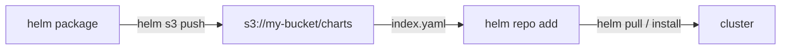
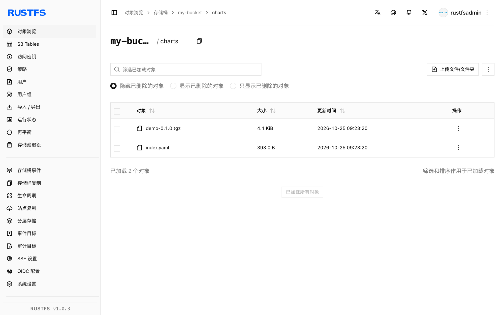

本指南将 Kubernetes 的 CNCF 包管理器 [Helm](https://github.com/helm/helm) 通过 [helm-s3](https://github.com/hypnoglow/helm-s3) 插件连接到 **RustFS**，让 RustFS 桶成为私有 Chart 仓库。你将在桶中初始化仓库、推送打包好的 Chart，再把仓库添加进 Helm 并拉回 Chart。整个流程使用 `alpine/helm:3.16.4` 和 helm-s3 `v0.17.2` 对 RustFS 桶验证通过。

你需要 Docker。本部署用于本地集成测试，不适用于生产环境。

## 架构



桶前缀中保存 `index.yaml` 和每个 Chart 版本一个 `.tgz`。Helm 通过插件读写它们，因此任何能访问 RustFS 的地方都能使用这个仓库。

## 1. 安装插件并初始化仓库

`alpine/helm` 镜像不带 `git`，因此从插件的发布压缩包安装，而不是仓库 URL：

```bash
cd /tmp
wget -q https://github.com/hypnoglow/helm-s3/releases/download/v0.17.2/helm-s3_0.17.2_linux_amd64.tar.gz
mkdir -p helm-s3 && tar -xzf helm-s3_0.17.2_linux_amd64.tar.gz -C helm-s3
helm plugin install helm-s3
```

通过插件自己的环境变量把它指向 RustFS，并初始化仓库前缀：

```bash
export AWS_ENDPOINT=<your-rustfs-endpoint>:9000
export AWS_DISABLE_SSL=true
export AWS_ACCESS_KEY_ID=<your-access-key>
export AWS_SECRET_ACCESS_KEY=<your-secret-key>
export AWS_DEFAULT_REGION=us-east-1

helm s3 init s3://my-bucket/charts
```

```text
Initialized empty repository at s3://my-bucket/charts
```

:::note[helm-s3 用 AWS_ENDPOINT，不是 AWS_ENDPOINT_URL]

插件用 `AWS_ENDPOINT`（主机与端口，不带协议）加 `AWS_DISABLE_SSL=true` 构造明文 HTTP 的请求 URL。标准的 `AWS_ENDPOINT_URL` 变量不会被识别，SDK 默认的虚拟主机寻址对 RustFS 会以 `403 Forbidden` 失败。

:::

## 2. 推送 Chart

第一次推送前先注册仓库——插件会读取 Helm 的仓库文件，文件不存在会报错：

```bash
helm repo add rustfs-charts s3://my-bucket/charts
```

创建并打包一个演示 Chart，然后推送。`helm s3 push` 接收的是**仓库名**，不是 `s3://` URI：

```bash
helm create demo
helm package demo
helm s3 push ./demo-0.1.0.tgz rustfs-charts
```

```text
Successfully uploaded the chart to the repository.
```

## 3. 从桶安装或拉取

刷新仓库索引，确认 Chart 可被发现：

```bash
helm repo update
helm search repo rustfs-charts/demo
```

```text
NAME              	CHART VERSION	APP VERSION	DESCRIPTION
rustfs-charts/demo	0.1.0        	1.16.0     	A Helm chart for Kubernetes
```

把 Chart 从 RustFS 拉回来：

```bash
helm pull rustfs-charts/demo --destination ./pullback
tar -tzf ./pullback/demo-0.1.0.tgz | head -2
```

```text
demo/Chart.yaml
demo/values.yaml
```



## 4. 停止或重置

Chart 就是普通的桶对象，清理即删除前缀：

```bash
aws s3 rm s3://my-bucket/charts --recursive \
  --endpoint-url http://<your-rustfs-endpoint>:9000
```

## 故障排查

### `helm s3 init` 报 `head s3 object: Forbidden`

插件在使用虚拟主机寻址——`AWS_ENDPOINT` 和 `AWS_DISABLE_SSL` 没有设置。按第 1 步原样导出它们。

### `check if index exists in the storage` 报 git 相关错误

镜像里没有 `git`，`helm plugin install <git-url>` 无法克隆。按第 1 步从发布压缩包安装。

### `The index file already exists under the provided URI`

仓库前缀之前初始化过。改用 `helm s3 init --ignore-if-exists s3://my-bucket/charts` 重跑，或加 `--force` 替换索引。

### push 时报 `repo with name s3://... not found`

`helm s3 push` 需要的是 `helm repo add` 注册过的仓库名——使用 `helm s3 push ./demo-0.1.0.tgz rustfs-charts`。

### push 时报 `couldn't load repositories file`

当前环境还没有 Helm 的 `repositories.yaml`。先执行 `helm repo add rustfs-charts s3://my-bucket/charts` 再推送。

## 下一步

- 在托管包含大量 Chart 版本的大型仓库前，先阅读 [S3 兼容性说明](/administration/protocols/s3)。
- 使用[访问密钥管理](/security-compliance/iam/access-token)创建专用的生产凭证。
- 按照 [helm-s3 文档](https://github.com/hypnoglow/helm-s3)在同一个桶上使用仓库重建索引、Chart 删除与 CI 集成。
