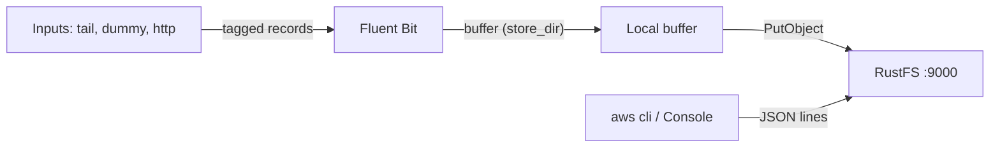
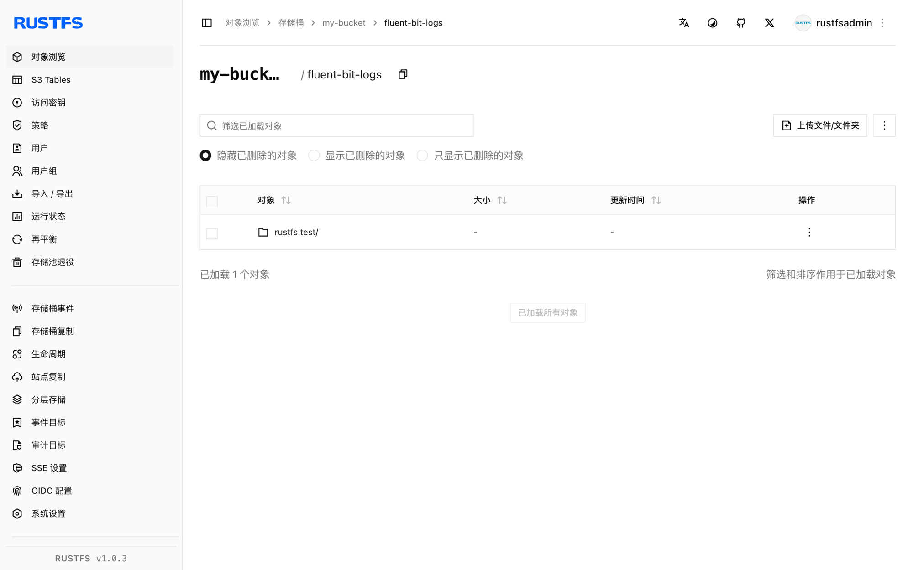

本指南将 CNCF 的日志处理器与转发器 [Fluent Bit](https://github.com/fluent/fluent-bit) 连接到 **RustFS** 作为日志目的地。你将运行带 `s3` 输出的 Fluent Bit，把记录缓冲到磁盘、上传进 RustFS 桶，并读回一条已投递的日志文件。整个流程使用 `fluent/fluent-bit:3.2.10` 以路径样式寻址写入 RustFS 桶验证通过。

你需要 Docker。本部署用于本地集成测试，不适用于生产环境。

## 架构



S3 输出把带标签的记录缓冲在 `store_dir` 中，文件达到 `total_file_size` 或 `upload_timeout` 到期时上传——以先到者为准。每个上传的对象是一个 JSON Lines 文件。

## 1. 创建桶

S3 输出从不创建桶，桶不存在时上传会报 `NoSuchBucket`。先创建桶，替换全部连接占位符：

```bash
aws s3 mb s3://my-bucket \
  --endpoint-url http://<your-rustfs-endpoint>:9000
```

## 2. 配置 S3 输出

创建 Fluent Bit 配置：

```text title="fluent-bit.conf"
[SERVICE]
    Flush 2
    Log_Level info

[INPUT]
    Name dummy
    Tag rustfs.test
    Rate 200

[OUTPUT]
    Name s3
    Match *
    endpoint http://<your-rustfs-endpoint>:9000
    region us-east-1
    bucket my-bucket
    total_file_size 1M
    use_put_object On
    upload_timeout 30s
    store_dir /tmp/flb-store
    json_date_key date
    json_date_format iso8601
```

`use_put_object On` 让每个缓冲文件用一次 `PutObject` 上传。`upload_timeout` 在缓冲未达到 `total_file_size` 时也会在 30 秒后强制上传——低流量输入必须设置它，否则记录会一直留在本地磁盘。

:::note[自定义端点默认就是路径样式]

Fluent Bit 3.2 没有 `s3_force_path_style` 选项——插件会把它当作未知属性拒绝。当 `endpoint` 指向自定义 S3 服务时，请求按路径样式访问桶，与 RustFS 默认行为一致，无需任何额外开关。

:::

## 3. 运行 Fluent Bit

启动容器并通过标准 AWS 环境变量传入凭证：

```bash
docker run -d --name fluent-bit \
  -e AWS_ACCESS_KEY_ID=<your-access-key> \
  -e AWS_SECRET_ACCESS_KEY=<your-secret-key> \
  -v "$PWD/fluent-bit.conf:/fluent-bit/etc/fluent-bit.conf:ro" \
  fluent/fluent-bit:3.2.10
```

等待第一次上传，并确认 worker 正常启动：

```bash
docker logs fluent-bit 2>&1 | grep "worker #0 started"
```

```text
[output:s3:s3.0] worker #0 started
```

## 4. 验证上传的对象

列出桶内容——默认 key 布局是 `fluent-bit-logs/<tag>/YYYY/MM/DD/HH/MM/`：

```bash
aws s3 ls s3://my-bucket/ --recursive \
  --endpoint-url http://<your-rustfs-endpoint>:9000
```

```text
2026-10-25 01:13:28  1021326 fluent-bit-logs/rustfs.test/2026/10/25/01/13/59-objectbmjH9744
2026-10-25 01:16:05   333735 fluent-bit-logs/rustfs.test/2026/10/25/01/15/34-objectKfCq13io
```

读回一个对象——每一行都是一条 JSON 记录：

```bash
aws s3 cp s3://my-bucket/fluent-bit-logs/rustfs.test/2026/10/25/01/13/59-objectbmjH9744 - \
  --endpoint-url http://<your-rustfs-endpoint>:9000 | head -2
```

```json
{"date":"2026-10-25T01:13:59.204844Z","message":"dummy"}
{"date":"2026-10-25T01:13:59.206396Z","message":"dummy"}
```



## 5. 停止或重置

保留桶内对象并拆除演示环境：

```bash
docker rm -f fluent-bit
```

删除已上传的日志：

```bash
aws s3 rm s3://my-bucket/fluent-bit-logs --recursive \
  --endpoint-url http://<your-rustfs-endpoint>:9000
```

## 故障排查

### `PutObject request failed` 且报 `NoSuchBucket`

输出桶不存在。按第 1 步创建桶——插件从不自建桶。

### `[config] s3: unknown configuration property 's3_force_path_style'`

Fluent Bit 3.2 没有这个选项。删掉它即可；自定义端点本来就使用路径样式寻址。

### 对象一直不出现且日志无报错

缓冲未达到 `total_file_size`，且没有设置 `upload_timeout`。加上 `upload_timeout 30s`，低流量输入就会定期上传。

### Fluent Bit 日志里出现 `InvalidAccessKeyId`

容器的凭证环境变量缺失或值有误。S3 输出读取 `AWS_ACCESS_KEY_ID` 和 `AWS_SECRET_ACCESS_KEY`。

## 下一步

- 在启用分段上传或压缩前，先阅读 [S3 兼容性说明](/administration/protocols/s3)。
- 使用[访问密钥管理](/security-compliance/iam/access-token)创建专用的生产凭证。
- 按照 [Fluent Bit S3 输出文档](https://docs.fluentbit.io/manual/pipeline/outputs/s3)在同一个桶上使用 `s3_key_format`、压缩与 `tail` 输入调优。
