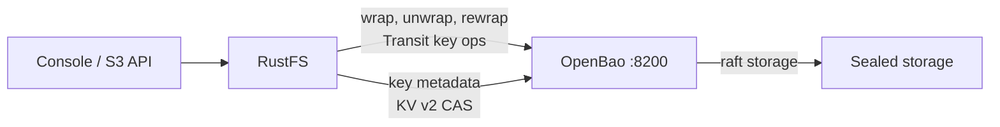
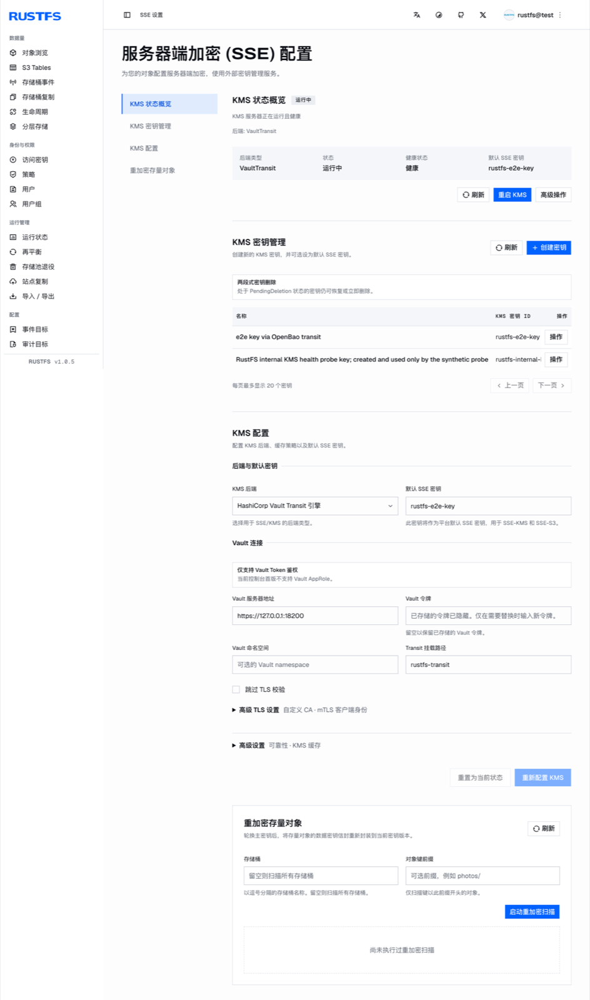

[OpenBao](https://github.com/openbao/openbao) 是 HashiCorp Vault 的开源分支。RustFS 通过其 Vault Transit 后端使用外部 KMS 管理 SSE-KMS 密钥，而 OpenBao 保持相同的 API 接口，因此无需修改 RustFS 代码——集成只需要配置。本指南部署 OpenBao、准备密钥引擎和最小权限令牌、配置 RustFS，并端到端验证 SSE-KMS。整个流程在 RustFS `1.0.5` 与 OpenBao `2.7.2` 上验证通过。

你需要 OpenBao 宿主机上的 Docker 和一台 RustFS 1.0.5+ 服务器。本指南是用于集成测试的单节点部署；生产部署还需要集群化 OpenBao 与托管解封，见文末说明。

## 架构



RustFS 在本地生成每对象数据密钥，并通过 OpenBao Transit 引擎包装；密钥生命周期元数据保存在 KV v2 挂载中（带 CAS 写入）。OpenBao 持有主密钥版本，因此 OpenBao 不可用时，新的 SSE-KMS 写入和已加密对象的读取会暂停，直到它恢复可达并完成解封。

## 1. 部署带 TLS 和 raft 存储的 OpenBao

RustFS 拒绝明文 HTTP 连接 KMS：启动即报 `Vault Transit requires HTTPS outside explicit development mode`。一开始就给 OpenBao 配好 TLS。创建目录结构和使用 raft 集成存储的配置：

```bash
mkdir -p /data/openbao/{data,config,tls}
openssl req -x509 -newkey rsa:4096 -sha256 -days 825 -nodes \
  -keyout /data/openbao/tls/ca-key.pem -out /data/openbao/tls/ca.pem \
  -subj "/CN=openbao-demo-ca"
openssl req -newkey rsa:2048 -nodes -keyout /data/openbao/tls/server-key.pem \
  -out /data/openbao/tls/server.csr -subj "/CN=openbao-host"
openssl x509 -req -in /data/openbao/tls/server.csr \
  -CA /data/openbao/tls/ca.pem -CAkey /data/openbao/tls/ca-key.pem \
  -CAcreateserial -out /data/openbao/tls/server-cert.pem -days 825 -sha256 \
  -extfile <(printf "subjectAltName=IP:127.0.0.1,DNS:localhost,DNS:openbao-host")
```

```hcl title="/data/openbao/config/config.hcl"
storage "raft" {
  path    = "/openbao/data"
  node_id = "openbao-1"
}
listener "tcp" {
  address         = "0.0.0.0:8200"
  cluster_address = "0.0.0.0:8201"
  tls_disable     = 0
  tls_cert_file   = "/openbao/tls/server-cert.pem"
  tls_key_file    = "/openbao/tls/server-key.pem"
}
api_addr      = "https://127.0.0.1:8200"
cluster_addr  = "https://127.0.0.1:8201"
disable_mlock = true
ui            = false
```

挂载数据、配置和 TLS 目录启动容器。这些 bind mount 必须对容器进程可写：

```bash
chmod -R a+rX /data/openbao/tls
chmod 777 /data/openbao/data
docker run -d --name openbao --restart unless-stopped \
  -p 127.0.0.1:8200:8200 \
  -v /data/openbao/data:/openbao/data \
  -v /data/openbao/config:/openbao/config \
  -v /data/openbao/tls:/openbao/tls \
  openbao/openbao:2.7.2 server
```

以单密钥分片初始化并解封。妥善保存解封密钥和 root 令牌——它们只显示一次：

```bash
docker exec -e BAO_ADDR=https://127.0.0.1:8200 -e BAO_CACERT=/openbao/tls/ca.pem \
  openbao bao operator init -key-shares=1 -key-threshold=1 -format=json
```

每次容器重启后需再次解封：

```bash
docker exec -e BAO_ADDR=https://127.0.0.1:8200 -e BAO_CACERT=/openbao/tls/ca.pem \
  openbao bao operator unseal <unseal-key>
```

## 2. 启用密钥引擎并创建受限令牌

RustFS 需要两个引擎：用于密钥操作的 Transit，以及存放它所维护密钥元数据的 KV v2。创建专用挂载：

```bash
docker exec -e BAO_ADDR=https://127.0.0.1:8200 -e BAO_CACERT=/openbao/tls/ca.pem \
  -e BAO_TOKEN=<root-token> openbao \
  bao secrets enable -path=rustfs-transit transit
docker exec -e BAO_ADDR=https://127.0.0.1:8200 -e BAO_CACERT=/openbao/tls/ca.pem \
  -e BAO_TOKEN=<root-token> openbao \
  bao secrets enable -path=rustfs-meta -version=2 kv
```

编写策略，只授予 RustFS KMS 客户端所需权限——Transit 密钥管理含 LIST（启动探测依赖它）、加密操作，以及已配置前缀对应的 KV v2 data 与 metadata 路径：

```hcl title="rustfs-kms.hcl"
path "rustfs-transit/keys" {
  capabilities = ["list"]
}
path "rustfs-transit/keys/*" {
  capabilities = ["create", "read", "update", "delete", "list"]
}
path "rustfs-transit/encrypt/*" {
  capabilities = ["create", "update"]
}
path "rustfs-transit/decrypt/*" {
  capabilities = ["create", "update"]
}
path "rustfs-transit/rewrap/*" {
  capabilities = ["create", "update"]
}
path "rustfs-transit/keys/*/rotate" {
  capabilities = ["update"]
}
path "rustfs-transit/keys/*/config" {
  capabilities = ["read", "update"]
}
path "rustfs-meta/data/rustfs/kms/keys/*" {
  capabilities = ["create", "update", "read"]
}
path "rustfs-meta/metadata/rustfs/kms/keys/*" {
  capabilities = ["read", "list", "delete"]
}
```

加载策略并签发 orphan 令牌：

```bash
docker cp rustfs-kms.hcl openbao:/tmp/rustfs-kms.hcl
docker exec -e BAO_ADDR=https://127.0.0.1:8200 -e BAO_CACERT=/openbao/tls/ca.pem \
  -e BAO_TOKEN=<root-token> openbao \
  bao policy write rustfs-kms /tmp/rustfs-kms.hcl
docker exec -e BAO_ADDR=https://127.0.0.1:8200 -e BAO_CACERT=/openbao/tls/ca.pem \
  -e BAO_TOKEN=<root-token> openbao \
  bao token create -policy=rustfs-kms -orphan -format=json
```

把令牌存放到 RustFS 宿主机。文件必须是属主只读权限并归 `rustfs` 服务账号所有——RustFS 会拒绝组或其他用户的读权限：

```bash
install -d -m 0755 -o rustfs -g rustfs /data/rustfs/kms
install -m 0600 -o rustfs -g rustfs /dev/null /data/rustfs/kms/openbao-token
# write the token into /data/rustfs/kms/openbao-token
cp /data/openbao/tls/ca.pem /data/rustfs/kms/openbao-ca.pem
```

## 3. 配置 RustFS

把 KMS 配置加入 RustFS 环境文件并重启：

```ini title="/etc/default/rustfs"
RUSTFS_KMS_ENABLE=true
RUSTFS_KMS_BACKEND=vault-transit
RUSTFS_KMS_VAULT_ADDRESS=https://127.0.0.1:8200
RUSTFS_KMS_VAULT_MOUNT_PATH=rustfs-transit
RUSTFS_KMS_VAULT_TOKEN_FILE=/data/rustfs/kms/openbao-token
RUSTFS_KMS_VAULT_TRANSIT_METADATA_KV_MOUNT=rustfs-meta
RUSTFS_KMS_VAULT_TRANSIT_METADATA_PREFIX=rustfs/kms/keys
RUSTFS_KMS_VAULT_CA_CERT=/data/rustfs/kms/openbao-ca.pem
```

```bash
sudo systemctl restart rustfs
```

如果后端校验失败，RustFS 会拒绝启动并在日志中写明具体原因——见[故障排查](#故障排查)。启动成功后，在控制台 **SSE 设置**下查看 KMS 状态，或通过管理 API：

```bash
curl -s http://localhost:9000/rustfs/admin/v3/kms/service-status
```

响应会报告 `"backend_type":"VaultTransit"`、`"healthy":true`、配置的地址、挂载路径以及是否使用自定义 CA。

## 4. 创建密钥并设置默认密钥

控制台在 **SSE 设置**下提供完整 KMS 生命周期：状态概览、密钥管理（创建、两段式删除）、后端配置，以及针对存量对象的重加密扫描。

在 **KMS 密钥管理**中创建密钥——RustFS 会同时在 OpenBao 里创建对应的 Transit 密钥，并在 KV v2 挂载中写入其元数据记录。然后在控制台或通过环境变量设置**默认 SSE 密钥**：

```ini title="/etc/default/rustfs"
RUSTFS_KMS_DEFAULT_KEY_ID=rustfs-e2e-key
```

修改默认密钥后重启 RustFS。绕过 RustFS 直接在 OpenBao 里建密钥会缺少 KV v2 元数据记录——请从 RustFS 侧创建密钥。



## 5. 端到端验证 SSE-KMS

设置桶默认加密，或在写入时指定密钥。上传响应会回显加密算法和密钥 ID，下载返回原始字节：

```bash
aws s3api put-object \
  --endpoint-url http://localhost:9000 \
  --bucket my-bucket --key docs/e2e-check.txt \
  --body ./e2e-check.txt \
  --server-side-encryption aws:kms \
  --ssekms-key-id rustfs-e2e-key
```

```json
{
    "ETag": "\"57a02aed...\"",
    "ServerSideEncryption": "aws:kms",
    "SSEKMSKeyId": "rustfs-e2e-key"
}
```

```bash
aws s3api get-object \
  --endpoint-url http://localhost:9000 \
  --bucket my-bucket --key docs/e2e-check.txt ./e2e-check-back.txt
```

## 验证结果

以下检查已在真实的 OpenBao 2.7.2 部署上执行，任何健康环境都应得到相同结果：

| 检查项 | 预期结果 |
| --- | --- |
| 使用密钥 ID 的 SSE-KMS PUT/GET | 响应回显 `aws:kms` 和密钥 ID；下载字节一致 |
| 加密对象的 Range GET | 字节区间正确返回 |
| RustFS 重启 | 密钥元数据从 KV v2 恢复；加密对象保持可读 |
| OpenBao 重启（sealed） | 加密读取失败并报 `ServiceUnavailable`——无明文回退；解封后读取在探测周期内自动恢复 |
| Transit 密钥轮换 | `latest_version` 递增且保留旧版本；轮换前包装的对象保持可读 |
| 存储上密文被篡改 | 读取失败且删除被拒绝；无明文回退 |
| 错误的加密上下文 | Transit 解密失败并报消息认证错误 |

存储布局说明：小对象的加密字节内联存放在每块盘的 `xl.meta` 文件中，因此对对象目录 grep 明文不会命中，尽管数据就在那里。

## 故障排查

### 启动失败并报 `Vault Transit requires HTTPS outside explicit development mode`

KMS 地址不是 HTTPS。给 OpenBao 配置 TLS，并通过 `RUSTFS_KMS_VAULT_CA_CERT` 信任其 CA。逃生开关 `RUSTFS_KMS_ALLOW_INSECURE_DEV_DEFAULTS=true` 仅供开发使用。

### 启动失败并报 `Vault token file ... has insecure permissions 0o644`

令牌文件必须是 `0600` 权限（组和其他位清零），且归 RustFS 服务账号所有：

```bash
chown rustfs:rustfs /data/rustfs/kms/openbao-token
chmod 600 /data/rustfs/kms/openbao-token
```

### OpenBao sealed 期间读取报 `ServiceUnavailable`

预期行为：加密读取依赖外部 KMS。解封 OpenBao；RustFS 会在下一次 KMS 探测时自动恢复——无需重启 RustFS。

### OpenBao transit 用错误的 `context` 参数也能解密

对非派生密钥，transit 会忽略 `context`，并把 S3 加密上下文绑定为 `associated_data`。错误的 `associated_data` 会以 `cipher: message authentication failed` 失败。手工通过 `bao` 测试绑定时请传 `associated_data`，而不是 `context`。

### 被篡改的加密对象无法读取也无法删除

两条路径失败都是设计使然——删除同样会校验存储的元数据。停止 RustFS 后从每块盘删除对象目录，再重启。

## 生产建议

上面的单节点 OpenBao 部署解封靠手动、存储在本地。生产环境：以集群方式运行 OpenBao（集成存储复制或自动解封机制），把解封凭据和 raft 数据备份独立于 RustFS 备份保护起来，并锁定 OpenBao 版本——每次升级前先验证 vaultrs 客户端。

## 下一步

- 查阅 [SSE-KMS](./kms.md) 中的后端总览与桶默认加密。
- 在采用更多 SSE 特性前，先阅读 [S3 兼容性说明](/administration/protocols/s3)。
- 使用[访问密钥管理](/security-compliance/iam/access-token)创建专用的生产凭证。
